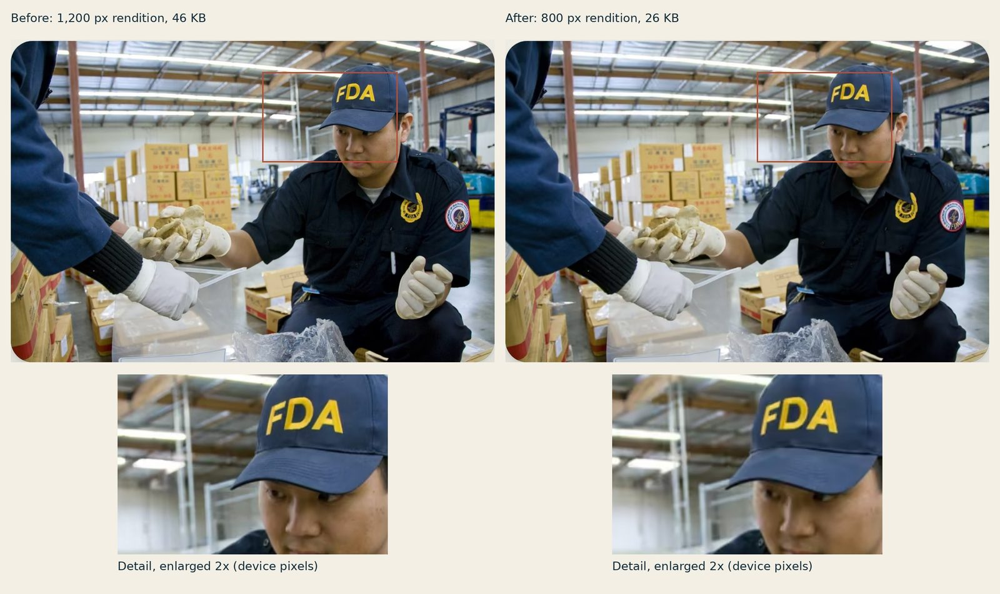

# Image weight: measured, and phones served at 2x

## Summary

Paul asked: "Are we wasting the bandwidth posting images at native size?" The measured answer is no.
- **No originals.** Readers never receive the original upload, which stays private in the database.
- **Right-sized already.** Each browser downloads the smallest of up to five renditions that covers the picture on its screen.
- **The measurement.** Across 15 page and screen combinations on the live site, nothing was larger than that.

**One saving remained.** Phones with very dense screens (3x iPhones, 2.6x Pixels) fetched each photograph at three times its width, and the detail beyond 2x is not visible at reading distance.

Version 0.7.2 serves those phones as if 2x, and it is live: phones now download about half the image bytes.
- **Home page:** 369 KB to 188 KB.
- **A story:** 214 KB to 113 KB.

Other screens are unchanged. A side-by-side at actual phone size shows no difference.

## What changed

- **Site builder (`src/lib/site/build.ts`).**
  - `imageSizes()` now builds every `sizes` attribute: for the cards, the lead story and the story hero.
  - It repeats each slot at two-thirds behind `(min-resolution: 2.5dppx)`, so phones denser than 2.5x choose a rendition as if they were 2x.
  - Screens up to 2x match none of those entries, and choose exactly as before.
  - Layout never depends on `sizes`: frames size their images in CSS.
- **Audit tool (`scripts/audit-images.mjs`, `pnpm --filter @sc/desk audit:images <site>`).** The measurement behind this entry, kept in the repository.
  - It loads each page cold on five screens: desktop 1x, laptop 2x, iPad, Pixel 7 and iPhone 13.
  - For every photograph, it compares the rendition downloaded with the smallest one covering the drawn width times the density the site serves.
  - It exits 1 if any image is larger or smaller than that.
- **Tests:**
  - A unit test for `imageSizes()`.
  - The end-to-end photograph test now opens the published story as an iPhone 13 (800 px rendition of a 900 px photograph) and as a desktop (900 px).
- **Live:**
  - Desk v0.7.2 runs on revision `sc-desk-00006-hq2` (1 GiB kept).
  - The site was rebuilt by one operator republish through the desk's publishing steps: 95 files, release `cc440e7e714cc853`.
  - That rebuild also put v0.7.1's versioned font and contour addresses live.
- **Docs:** CHANGELOG 0.7.2; `docs/LAUNCH_PREVIEW.md` (image weight and the audit command); the visual codex rule "Serve phones at 2x, not 3x".

## Decisions

- **Cap at 2x for screens of 2.5x and above; leave everything else alone.**
  - On a 356-pixel slot, a 3x phone would take a 1,200 px rendition. At 2x it takes the 800 px one, about half the bytes, and the difference cannot be seen at arm's length.
  - Desktops, laptops and tablets are at most 2x and are untouched.
  - This is common practice for photographs; screenshots of text or charts may later deserve full density, and the helper allows a different policy per use.
- **Make the measurement a repository tool, not a one-off.** "Are images right-sized?" will come up again with every new layout or redesign. The audit answers it in a minute on any site.
- **Rebuild the live site now with an operator republish.** It is the same path used for the samples' photographs earlier. The content is unchanged, and the rebuild also carried v0.7.1's versioned assets live.

## Problems and resolutions

- **The Docker daemon stopped in the middle of the gates** (a session restart). The reset, pgTAP and Playwright failed because the database was gone, while `pnpm check` and the build passed. Docker was restarted, the Supabase containers came back on their own, and the three steps re-ran green.
- **The first version of the audit judged phones against their full 3x.** After the change it reported a confusing "-33.7% excess". It now applies the same density policy as the site, and reports each image as over or under.

## Evidence

- **EV-0069 (before):** 15 views, 2,475 KB of images, all right-sized for full density. Phones: 369, 214 and 52 KB per page.
- **EV-0070:** pgTAP 272/272, Vitest 132/132, Playwright 32/32 (including the iPhone and desktop rendition check), `pnpm check`, bundle scan.
- **EV-0071:** desk v0.7.2 live with 1 GiB. Operator republish job `9d7206af` succeeded. The capped `sizes` and the versioned assets are live and served immutable.
- **EV-0072 (after):**
  - phones: home 188 KB, story 113 KB, section 24 KB;
  - other screens unchanged;
  - 15 views, 1,852 KB in total, with 0 images over or under the right rendition;
  - the story photograph went from 46 KB to 26 KB.

## Risks and open questions

- **Older Safari** (before version 16) does not support the resolution media feature in `sizes`. Those phones fall back to the previous choice, so nothing breaks.
- **Charts, maps and screenshots with small text** may deserve full density on phones. When the site carries them, give them their own `imageSizes()` policy.
- **Publishing still reads every published image from the database on each build** (ADR-006 review trigger: about 200 MB). That is bandwidth inside our own systems, not to readers. The fix, when needed, is to store each rendition's upload hash so a build fetches only what Firebase asks for.

## Next actions

1. **Paul:** unchanged from turn 7. Do the security clean-up, the first live update and a first photograph, confirm ADR-006, and approve the standing pages.
2. **Optional:** run `pnpm --filter @sc/desk audit:images <site>` after any layout change. It exits 1 if an image is over- or under-sized.
