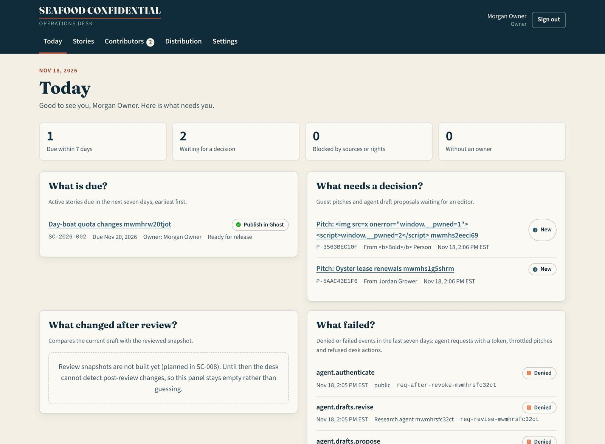
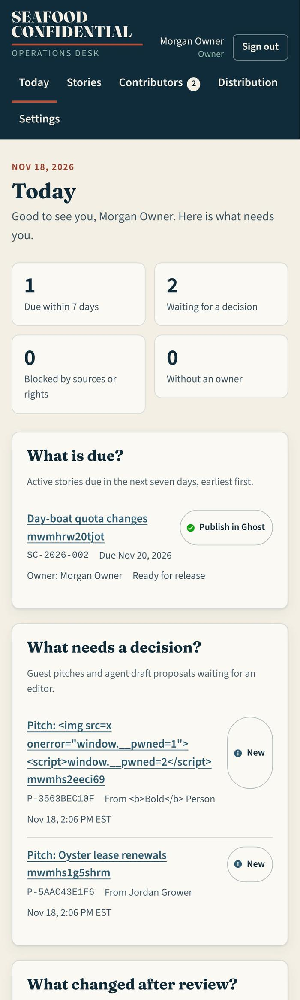
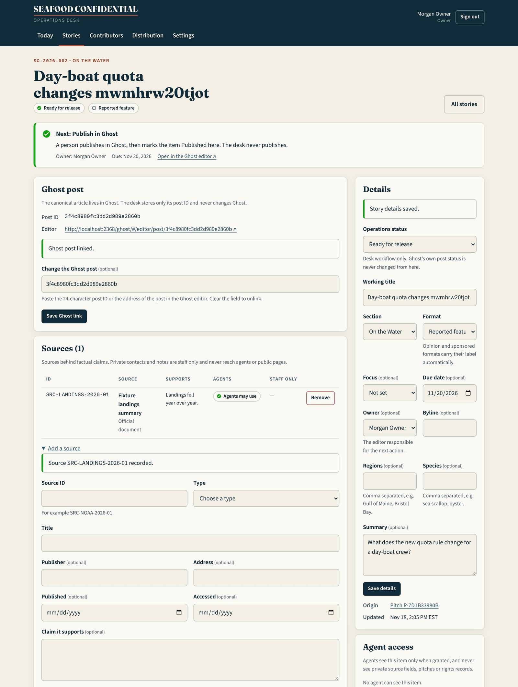
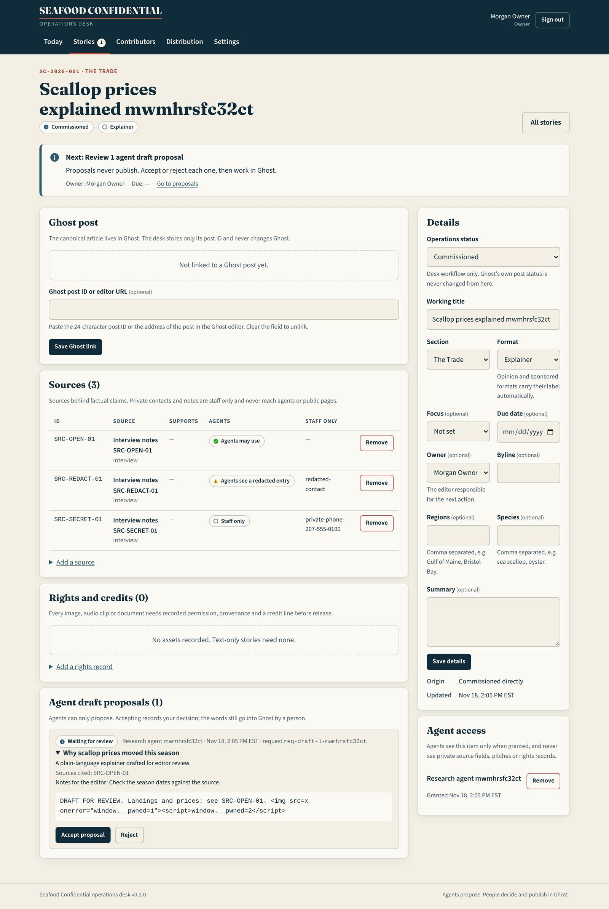
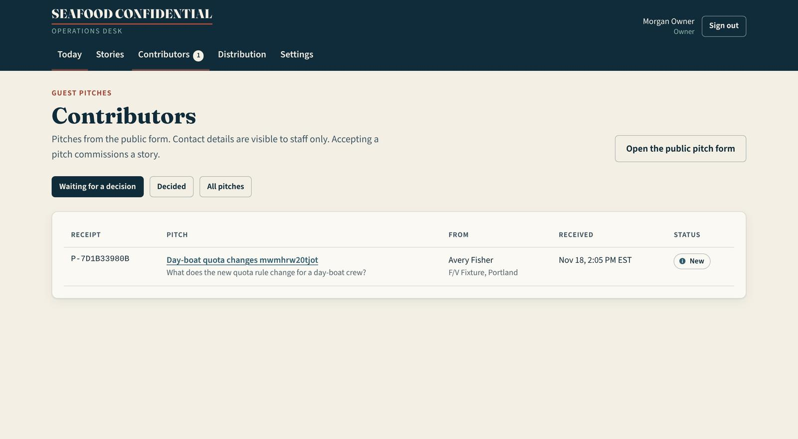
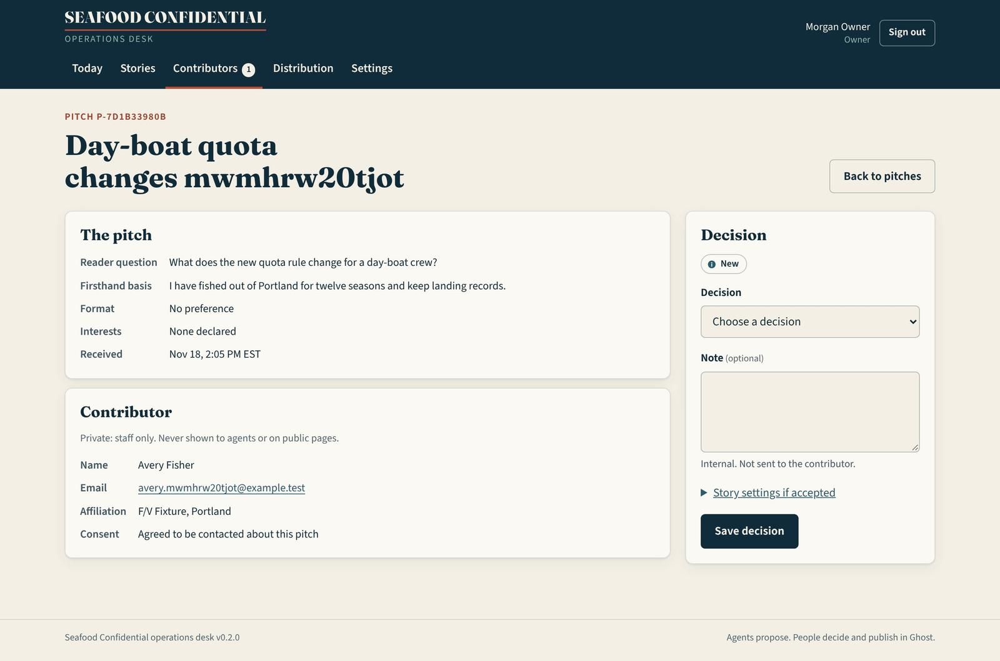
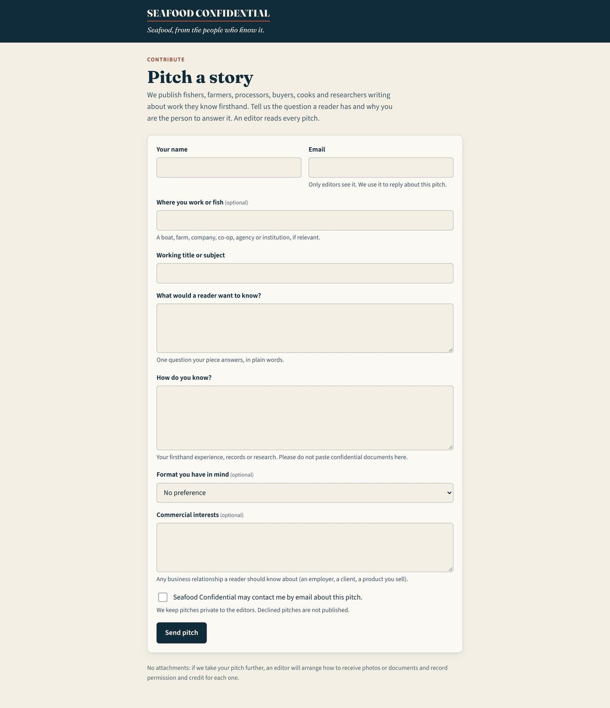
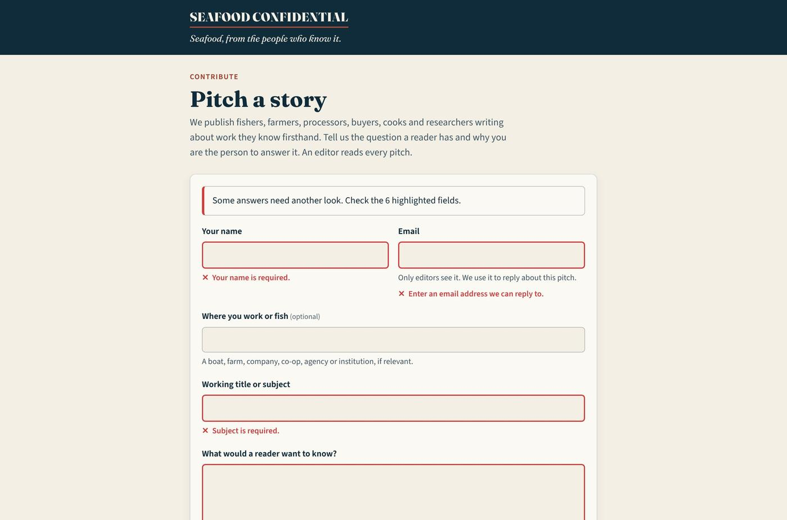
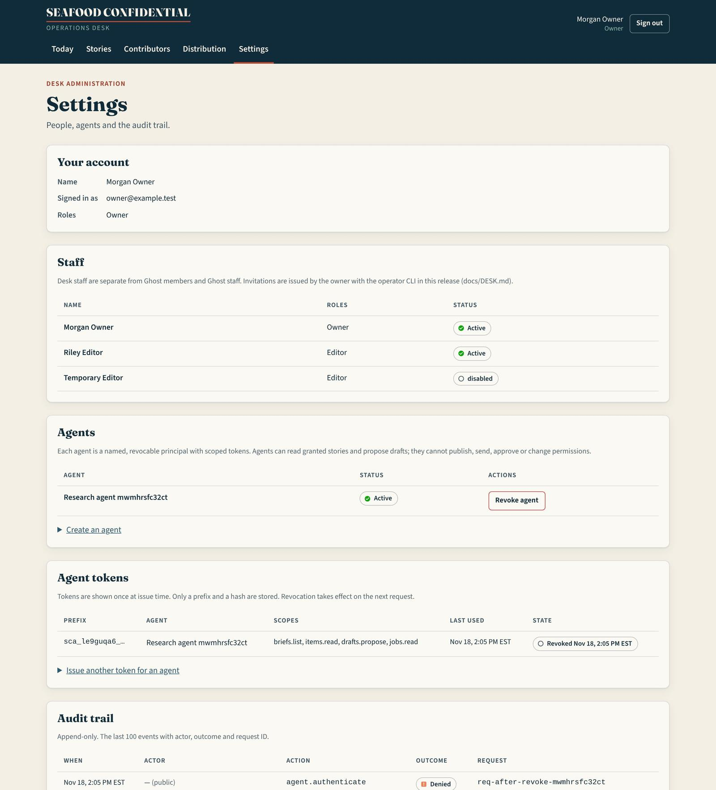

# Operations desk foundation and first vertical slice

## Summary

The private operations desk now exists and runs end to end on a local Supabase stack. Staff sign in with a one-time email link; a public pitch becomes a queued pitch, then a commissioned story with an owner, a single next action, a unique link to its Ghost post, source records and rights records, and a release gate that refuses "ready" until sources and credited, cleared rights exist. Agents can read only the stories they are granted, with confidential sources hidden, and can only propose drafts that wait for a person. Every request and change lands on an append-only audit trail with a request ID. Nothing is deployed and nothing publishes: Ghost stays the only place where people publish.

## What changed

**Database (`supabase/`)**
- One migration creates the `app` schema (principals, staff assignments, pitches, editorial items, sources, asset rights, agent grants, draft proposals) and the `private` schema (hashed agent credentials, audit trail, intake throttling). Every table has Row Level Security and explicit grants.
- The desk connects as `desk_app`, a login role with no privileges of its own, and switches to `authenticated`, `desk_agent` or `anon` inside each transaction after binding the caller (ADR-003). Agent tokens are verified inside the database, so revocation applies on the next request.
- Workflow functions: `submit_pitch` (consent-gated, bounded, throttled per client and overall, returns only a receipt, and records throttled attempts), `dispose_pitch` (locks the pitch, issues the next `SC-YYYY-NNN` content ID on acceptance), agent credential issue/revoke/list for owners, and an audit function whose actor is always derived, never supplied. Trigger-written audit rows inherit the transaction's request ID.
- 93 pgTAP assertions in four files cover grants, RLS, staff isolation, agent isolation and revocation, intake, disposition and the audit trail.

**Desk app (`apps/desk/`)**
- Next.js 16.4 (App Router, React 19.3, TypeScript 6.0.3) with a Node `proxy.ts` that assigns request IDs, sets a nonce Content-Security-Policy and refreshes the Supabase session; hardening headers in `next.config.ts`.
- Pages: Today (what is due, what needs a decision, an honest empty "what changed after review", what failed), Stories (filters, commissioning, story detail with next action, Ghost link, sources, rights, agent proposals and agent access), Contributors (pitch queue and decisions), Distribution (states plainly that nothing is built or sent yet), Settings (staff, agents, one-time token display, token revocation, audit trail), sign-in, `/no-access`, the public `/pitch` form, error and not-found pages.
- Working Waterfront tokens compiled from `brand/tokens.json`, self-hosted Fraunces and Source Sans 3, status always shown as icon plus label, accessible forms with linked errors and focus management.
- Agent gateway `POST /api/agent/v1` on the kit contract: `briefs.list`, `items.read` (server-side redaction), `drafts.propose` (cited sources must exist and be visible; durable idempotency with conflict detection), `jobs.read`; `drafts.revise` and `social.propose` answer 501 until SC-008 and SC-011.
- Telemetry: OpenTelemetry through `instrumentation.ts`, pino JSON logs with trace IDs and redaction, request-error hook.
- Operator CLIs for local work and first-owner bootstrap (`staff`, `agent`), and `env:local`, which writes separate git-ignored environment files for the app and for the CLIs so the app never holds the Supabase secret key.

**Tests, CI and tooling**
- Vitest (unit), Playwright (end to end, desktop and phone) with axe WCAG 2.2 AA on every page visited, and a client-bundle secret scan.
- CI gains a `desk` job that starts a local Supabase stack and runs database tests, static checks, the production build with the bundle scan, and the end-to-end suite.
- Root scripts `desk:*` and `db:*`; `pnpm check` runs the desk's static checks. Validators skip build output; gitleaks allowlists only build output and the two local env files.

**Docs and tracking**
- `docs/DESK.md` (architecture, security model, gateway reference, setup, tests, telemetry), ADR-003 updated with the decisions made while building, README map, AGENTS.md desk conventions, CONTRIBUTING version rule, CHANGELOG 0.2.0.

## Decisions

- **Developer defaults, not founder decisions.** The planning brief's recommendations became ADR-003 defaults so work could start; founder questions (accounts, budget, channels) stay open and block only hosted deployment.
- **Cache Components off.** Every desk page is per-user; revocation must apply on the next request; nonces need per-request rendering.
- **One authorization boundary.** RLS decides; the app re-checks identity everywhere but never widens access. SQL is tagged templates only (lint-enforced).
- **Throttled intake returns no receipt instead of raising,** so the denial stays on the audit trail (an exception would roll it back).
- **Client addresses for throttling** honour only `DESK_TRUSTED_PROXY_HOPS` proxies from the right of `X-Forwarded-For`; anything a client prepends is ignored.
- **Agents never see Ghost IDs** (only `ghostLinked`), pitches, rights records or private source columns.
- **Kept ESLint 9.39** (ESLint 10 blocked by plugin peer ranges) and **`@opentelemetry/api` 1.9.1** (required by `@vercel/otel` 2.3).

## Problems and resolutions

- The test runner could not `SET ROLE desk_agent`: Postgres 16+ gives a role's creator ADMIN without SET. Fixture grants SET inside the test transaction only.
- pgTAP failed while acting as an agent (no USAGE on `extensions`): granted within the test transaction.
- A throttled pitch's audit row vanished with the raised exception: the function now returns NULL.
- `/pitch` prerendered statically, so its scripts had no nonce: it renders per request.
- Fontsource registers `Fraunces Variable`, not `Fraunces`: the desk's token build prepends the variable family names.
- React's purity lint flagged `Date.now()` in Server Components: time filters moved into SQL.
- Visual review found three defects: due dates shown a day early (UTC dates formatted in New York time), the rust rule spanning the whole masthead, and the rights picker reverting after a save (React 19 form reset). All fixed and re-verified in screenshots; the phone nav now wraps so Settings is visible.
- The end-to-end suite tripped the real intake throttle after several runs from 127.0.0.1: tests now act as distinct documentation-range clients, and production honours only trusted proxy hops.
- **Independent security review** (a separate agent, adversarial, probing as an editor and as an agent): no Critical or High findings; three Medium and five Low, all fixed and covered by new assertions. Anonymous gateway traffic no longer touches the database or the audit trail, failed authentications are limited per client, gateway transactions are capped so staff keep connections, and each agent has a request budget counted in the database. Intake throttling trusts only configured proxy hops (required in production) and is serialized. Staff can update only workflow columns; reviewers and deciders are stamped by the database; cleared rights need a credit line; sources, rights and refused actions are audited. Agents read sources only through a SQL function that redacts, can insert only proposal content columns, can record only `agent.*` events, and stay revoked for good, with their tokens. Request IDs are strict and allow-lists ignore prototype keys.
- Recording the agent-only audit rule first broke trigger-written audit rows for agent proposals; audit writing was split into an internal writer for triggers and a restricted API entry point.
- The mutation harness showed some audit-count assertions also counted rows from earlier end-to-end runs, and fixtures collided with existing identities: assertions are now scoped to the test's own transaction and fixture emails are unique, so the suite is correct on fresh and used databases.

## Evidence

| ID | Kind | Result | What it shows |
| --- | --- | --- | --- |
| EV-0019 | test | pass | 108 pgTAP assertions on local Supabase, also on a database already used by end-to-end runs (AT-03, AT-04, AT-06, AT-07, AT-12, AT-13, AT-25 at the database layer) |
| EV-0020 | test | pass | Mutation test: all 11 deliberate policy breaks are caught by named assertions |
| EV-0021 | test | pass | 67 unit tests, including every contract example |
| EV-0022 | test | pass | 24 end-to-end tests on a production build, desktop and phone, zero axe WCAG 2.2 AA violations (AT-03, AT-04, AT-06, AT-07, AT-12, AT-13, AT-18) |
| EV-0023 | test | pass | No secrets in bundles, gateway responses or logs, with a planted-secret control (AT-23) |
| EV-0024 | review | pass | Independent security review: no Critical or High; every Medium and Low finding fixed and re-tested |
| EV-0025 | observation | info | Visual review: four defects found, fixed and re-verified |

Commands: `pnpm db:test`, `pnpm --filter @sc/desk test`, `pnpm desk:build`, `pnpm desk:e2e`, `pnpm check`. Scenario statuses in `docs/ACCEPTANCE_TESTS.md` changed from UNRUN to PASS for AT-03, AT-04, AT-06, AT-07, AT-12, AT-13, AT-18, AT-23 and AT-25: deliberate kit edits backed by the records above, on the local stack only. SC-005, SC-006, SC-007 and SC-009 moved from planned to in progress.

### Visual results

| | |
| --- | --- |
|  |  |
|  |  |
|  |  |
|  |  |
|  |  |

A signed-in identity without a staff role sees only [the no-access page](../assets/2026-11-18-s01-t2/desk-no-access-desktop.jpg). All names and addresses in the screenshots are test fixtures.

## Risks and open questions

- Hosted Supabase must accept the role-membership grants and transaction-scoped settings through its pooler (ADR-003 review trigger); verify in staging (SC-015).
- Staff invitations and role changes are CLI-only in this version.
- The gateway's flood guards are per instance; several instances need a shared or platform limiter in front.
- The audit trail is append-only and unbounded; retention and archiving belong with exports and backups (SC-014).
- The global intake ceiling protects storage but lets a determined sender pause intake for an hour; a privacy-respecting challenge (for example Cloudflare Turnstile) is a founder decision.
- The `desk_app` connection is the trust boundary for identity binding: keep the URL server-only.

## Next actions

1. Founders: answer the SC-001 account and budget questions so a hosted Supabase project and a deployment target can be created.
2. SC-002: Ghost publication and staff roles, then real Ghost post IDs flow into the desk.
3. SC-008: read-only review snapshots and stale detection, which unlock `drafts.revise` and the "What changed after review?" panel.
4. Continue SC-009: an MCP adapter on the same gateway, correction proposals for published items (AT-05).
