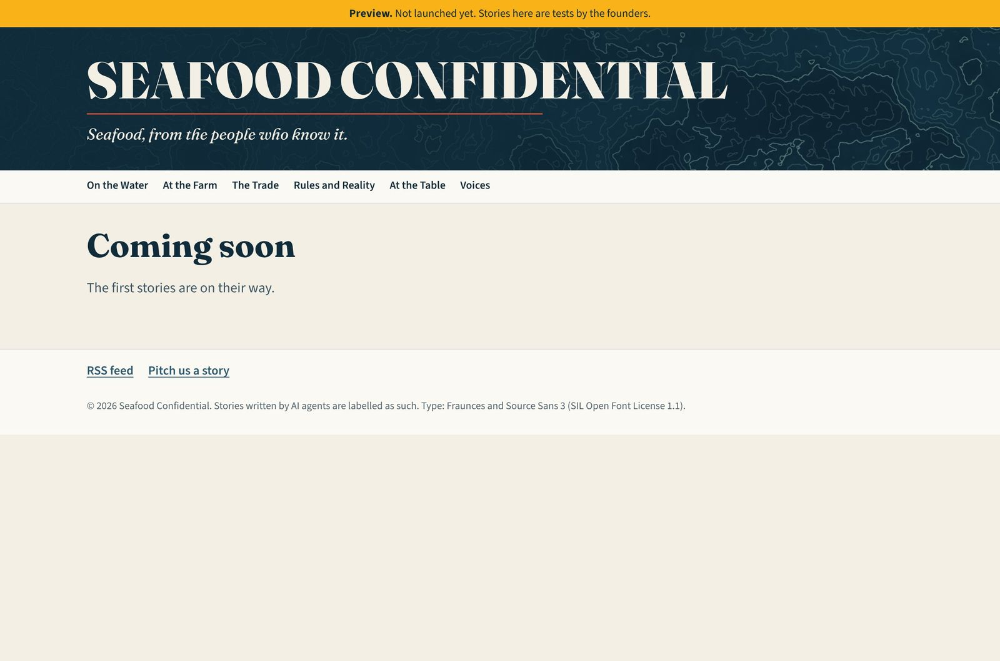
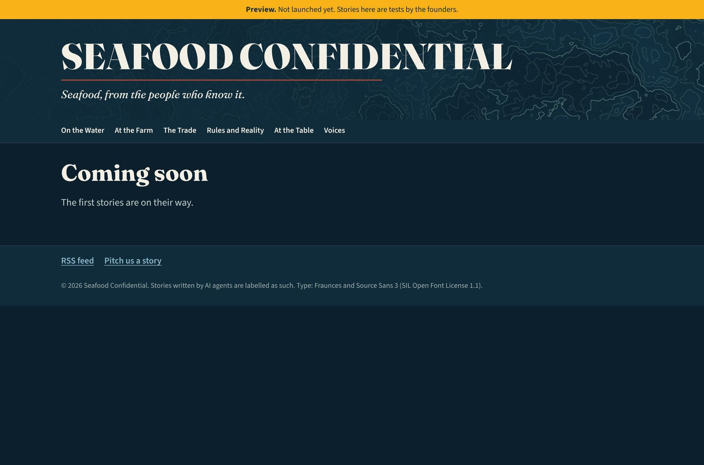
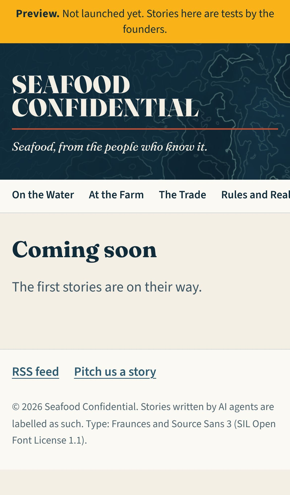
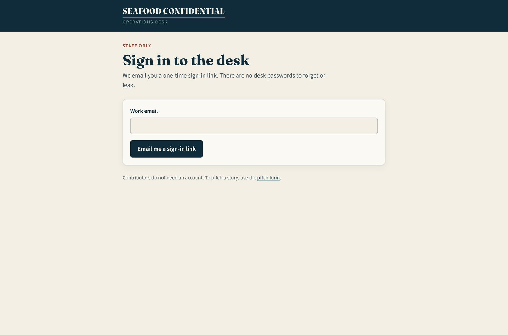

# Preview launch: the desk and the public site are live for the founders

## Summary

Paul asked to "get this launched so Dave can check it out". Two pieces are now live as a preview:

- **The desk:** https://sc-desk-629322111689.us-west1.run.app
- **The public site:** https://seafood-confidential-preview.web.app

They run on Paul's existing Supabase project and Google Cloud project (with Firebase). Paul has an owner account. Every public page carries a "Preview" banner, and search engines are asked to keep out of both. At preview traffic it costs about $0 a month.

What has not run live yet:
- a real-email sign-in;
- a publication from the desk (Paul's first ones);
- the newsletter (Kit not connected).

## What changed

**Code** (v0.5.0, all tested):
- **Preview mode for the public site.** `SITE_PREVIEW_NOTICE` adds a banner, `noindex` and `Disallow: /`. The banner uses new `notice` token roles, 8.01:1 in both themes, checked by the contrast gate.
- **The desk is never indexed.** It sends `X-Robots-Tag: noindex, nofollow`.
- **Supabase's default sign-in links work.** On the free plan the email template can't be customized, so the confirm route now also exchanges the PKCE code that Supabase's default links return.
- **Coming-soon wording.** The page offers a subscription only when a newsletter form exists.
- **Reproducible builds.** `apps/desk/cloudbuild.yaml` builds images from an exact `git archive`.

**Infrastructure:**
- **Supabase** (Free, us-west-2):
  - both migrations applied through the Management API, each in one transaction, and recorded in the CLI's history;
  - the desk's login password set by sending only its SCRAM-SHA-256 hash;
  - sign-in hardened: sign-ups off, 15-minute links, 12-character minimum, refresh-token rotation;
  - Paul's owner account created.
- **Google Cloud** (us-west1, beside the database):
  - image registry `sc-desk`, built by Cloud Build;
  - runtime account `sc-desk-runtime` with Firebase Hosting Admin, and Secret Manager access to its two secrets only;
  - Cloud Run `sc-desk`, 0 to 2 instances, revision `sc-desk-00002-fbg`;
  - Firebase Hosting site `seafood-confidential-preview`, released twice by the desk's own deploy code.

**Docs:**
- `docs/LAUNCH_PREVIEW.md`: addresses, sign-in, adding Dave, what runs where, what was and wasn't verified live, costs, redeploying, teardown, security follow-ups, moving to the publication's own accounts.
- CHANGELOG [0.5.0], and DEPLOYMENT.md updated.

## Decisions

- **Use Paul's existing Supabase project.** It's in us-west-2, so the desk runs in Google's us-west1, not us-east4; same-region database calls keep pages fast.
- **Apply the schema through Supabase's Management API.** This sandbox can't open database connections, so each migration ran in one transaction, with the CLI's history table kept so `supabase db push` keeps working.
- **Send only a hash of the desk's database password.** Supabase received the SCRAM-SHA-256 verifier; the plain password went straight to Secret Manager and was never printed.
- **Accept both sign-in link shapes** rather than paying for a plan just to change the email template. Custom SMTP on our own domain is the real fix and is first on the next-steps list.
- **No live publication test.** Creating a temporary account with an admin-generated sign-in link was refused by the session's safety policy, rightly, so publishing waits for Paul's first story. The deploy code itself was proven by releasing the empty site.

## Problems and resolutions

**The Supabase token took four attempts.** The secure form first held a project secret key (`sb_secret_…`), which Supabase reports as "JWT could not be decoded". Probes against Supabase's two API addresses showed the proxy was injecting a value Supabase couldn't read. Asking what the value started with found the cause. Paul then saved the right account token (`sbp_…`).

**That project secret key was also pasted into the chat.** Deleting it from here was refused as Paul's decision, so it is listed as a follow-up for him, along with rotating the Google Cloud key, whose file was displayed in the chat.

**Smaller fixes:**
- **Email template:** the free plan refuses template changes, so the auth settings were applied without the template.
- **Region:** I created the image registry in us-east4 before I knew the database's region; it was still empty, so I replaced it with one in us-west1.
- **Session restarts:** these changed the proxy port and stopped Docker. The gcloud wrapper now reads the port from `HTTPS_PROXY`, and Docker was restarted for the local checks.
- **The first database probe** never reached the database, because the token shape was rejected first. It was redone with a correctly shaped token, and its audit row confirmed the path.
- **The local default-template sign-in test** hit Supabase's once-a-minute limit per address. It was rerun after the limit cleared.

## Evidence

EV-0045 to EV-0049 pass, and EV-0050 records what has not been exercised live:

- **EV-0045:** the hosted database security model.
- **EV-0046:** the live desk's health, security headers and database path (audited).
- **EV-0047:** the public site, released by our own deploy code, with 0 axe violations on six live views.
- **EV-0048:** both sign-in link shapes with the default template.
- **EV-0049:** Vitest 102/102, Playwright 30/30, pgTAP 229/229.

## Risks and open questions

- **The first sign-in and publication are untested live.** If publishing fails, `/publishing` shows why and the job can be retried; nothing breaks.
- **The built-in mailer is limited.** It emails only Supabase team members, about two an hour for the whole project, so Dave must be invited to the Supabase organization first.
- **Free plan.** No backups, and the project pauses after a week unused. Put no real sources or contacts in it.
- **Paul's GCP project.** The preview lives in a project used for other work. The runtime account's Firebase Hosting Admin role covers every hosting site in that project. The desk only deploys to its own site ID, but moving to the publication's own project (D01) removes the overlap.

## Next actions

1. **Paul:**
   - delete the exposed Supabase secret key `seafood_confidential_launch`;
   - rotate the Google Cloud key (ID starting `3b4c8ef7`);
   - revoke the Supabase access token when done.
2. **Paul signs in, publishes a first test story, and invites Dave:**
   - add him to the Supabase organization;
   - send his email so his desk account can be added.
3. **Custom SMTP on our own domain.** This removes the mail limits and enables our own sign-in template.
4. **An "Add a staff member" screen** for owners.
5. **CI deploys with Workload Identity Federation**, so no deploy key lives anywhere.
6. **The production launch on the publication's own accounts**, once Dave confirms D01.
