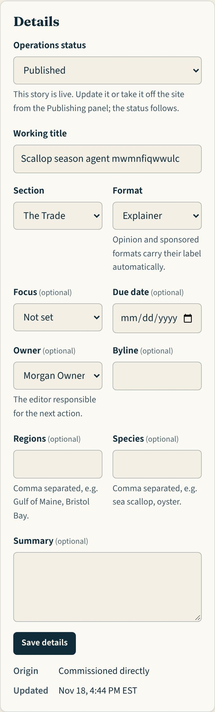
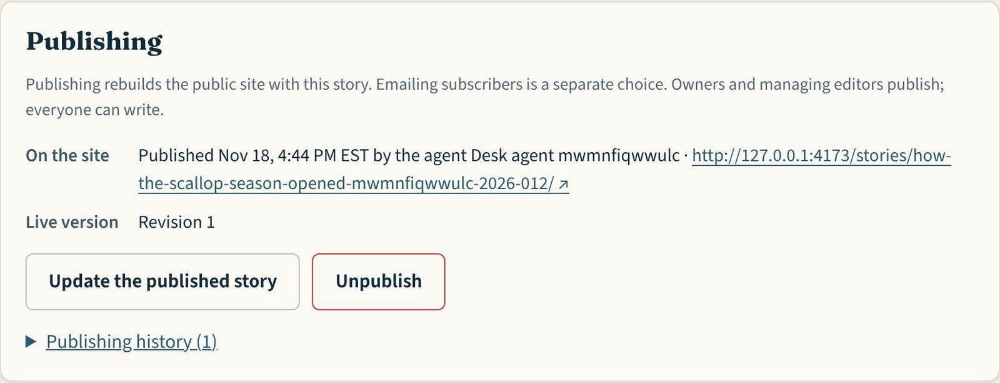
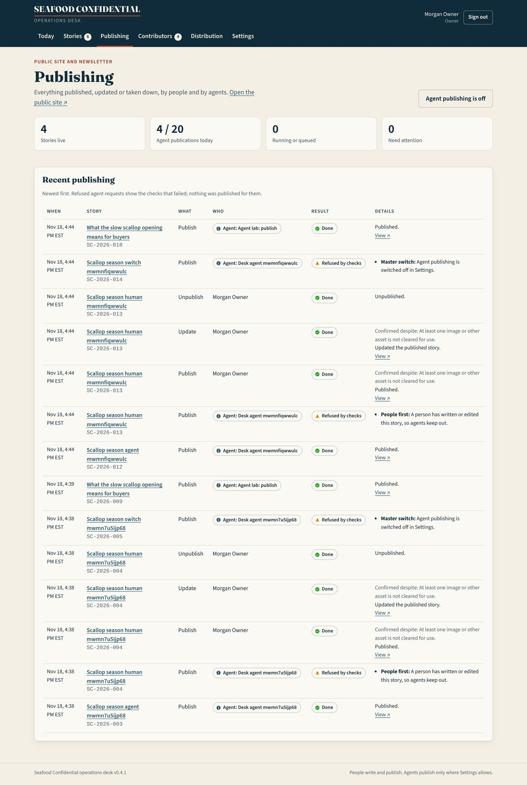
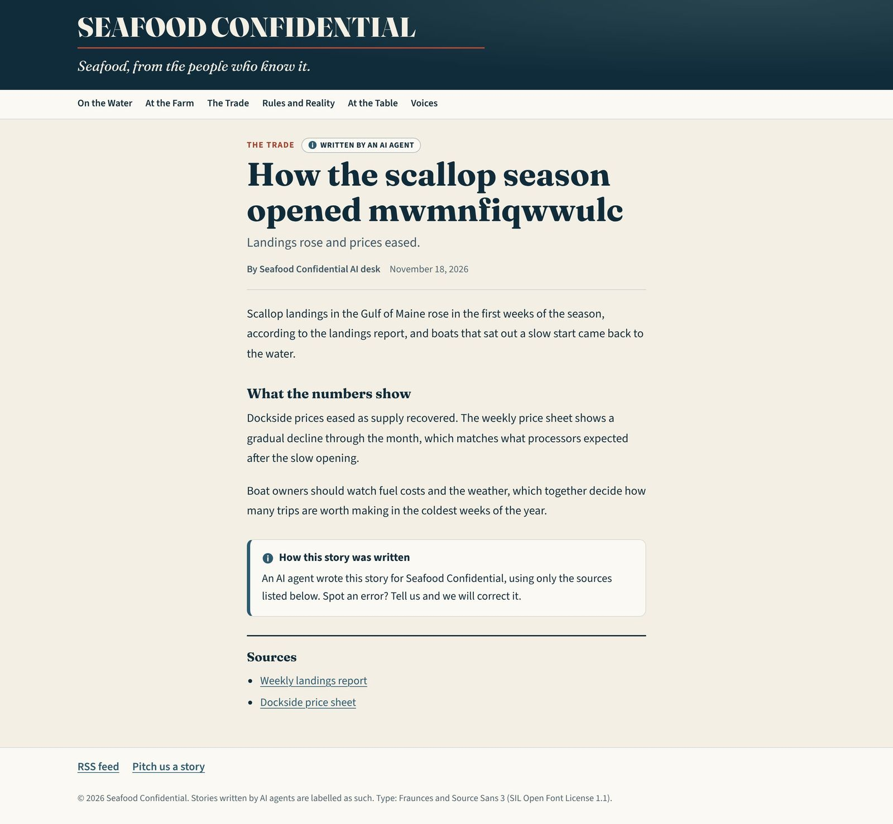

# Publishing security hardening: what is live is what was published

## Summary

Before handing v0.4.0 over, a separate agent reviewed agent publishing adversarially. It found eight problems:

- **High:** the live site was rebuilt from text editors were still working on, and from a status anyone could set by hand.
- **Medium (four):** stale agent jobs ran without full re-checks; overlapping workers could deploy twice or email twice; one bad job could block the queue; and refused agent requests were silently rolled back.
- **Low (three):** content checks that could be probed or bypassed, and two bugs in the local site server.

All eight are fixed in **v0.4.1**, each with a regression test. Fixing them turned up eight more problems, which are also fixed and tested. Every suite passes on the final build, and the container image is rebuilt and smoke-tested.

## What changed

**Database** (`supabase/migrations/20261118200000_publishing.sql`):
- **Published revision:** each story records the revision it was published at (`published_revision`). Every rebuild uses it, so an editor's later save never goes live until a person updates the story. A trigger stops API roles from setting Published, or leaving it, by hand.
- **Claim token:** `app.claim_publish_job` returns a claim token, and `site_snapshot`, `mark_email_attempt`, `renew_publish_lease` and `complete_publish_job` all require it. A worker whose lease expired is locked out.
- **Email:** `mark_email_attempt` is a compare-and-set that returns true at most once per job.
- **Re-checks at claim:** the credential (revoked, expired or out of scope), the agent account and every gate are checked again. A job whose conditions changed is cancelled with the reason, and the claim says so (`{cancelled, message}`).
- **Retries:** a retry keeps the revision the job froze. A retry of a job whose revision is already live finishes it without a re-check (it can publish nothing new). A job that cannot be prepared fails (`{failed}`) instead of blocking the queue.
- **Gate order:** preconditions (switch, lane, grant, people-first, in flight, format, daily cap, email) run first, and content checks run only if they pass. Agents get 10 refused requests a day (`refusal_limit`).
- **New content checks:** headline and summary fit; links point only at cited sources; HTML character references; block quotes inside lists; emails and phones found in a flattened copy of the text (Markdown escapes, emphasis markers and invisible characters removed); international phone numbers; and private contacts split by emphasis.
- **Addresses:** accented letters are transliterated (São → sao, Straße → strasse); a title with no Latin letters falls back to `story-…`; no double or leading hyphens.
- **Staff:** "publish" on a live story is refused (update it instead, so subscribers are never emailed twice). Publishing again with email after an unpublish warns `already_emailed`.

**Desk server:**
- **Executor:**
  - every step after the claim carries the token;
  - the lease is renewed every minute and confirmed right before the release;
  - Kit is called only when the email mark returns true;
  - the rendered text of an agent story (`site/contact.ts`) is checked once more before deploying;
  - nothing throws to the caller.
- **Deploy destinations** take a stop signal and a `beforeRelease` hook. A lost claim leaves the live site untouched, for both the local folder and Firebase Hosting.
- **Gateway:**
  - a refusal is returned as a committed 422, so the job, the audit row and the refusal budget all hold;
  - `jobs.read` returns the refusal;
  - agents get agent-facing messages, never editor-facing hosting or database errors.
- **Local site server** (`serve-site.mjs`): malformed escapes return 400 instead of crashing the process; directory redirects are built from the file system.

**Desk UI:**
- On a live story the status picker offers only Published, with a hint pointing to the Publishing panel. The action gives the same explanation to a crafted request.
- The unused Ghost link action is removed.
- The publishing log names failed checks briefly ("**Master switch:** Agent publishing is switched off in Settings").

**Docs and tracking:**
- CHANGELOG [0.4.1].
- DESK.md: publishing safeguards, security model rows and test counts.
- Acceptance tests: AT-31 (live site stays at the published revision) and AT-32 (overlapping workers are fenced) added as PASS; AT-28 widened.
- Visual codex: two reusable patterns, "state a workflow owns" and "failed checks".
- Version 0.4.1 everywhere.

## Decisions

- **Retries of live agent jobs are not re-checked.** They can only redeploy the revision that is already live, and the email marker stops a second newsletter. Re-checking would cancel them with a misleading reason (the proposal is already published).
- **Transliteration lives in SQL** (`translate` with a generated table of Latin letters). `unaccent` would need an extension and is not immutable.
- **Agents see failure details only for their own outcomes** (succeeded, cancelled, refused). Hosting and database errors stay with editors on the Publishing page.
- **The rendered-text check runs only for agent stories.** People are warned, never blocked (ADR-005).

## Problems and resolutions

- **Isolation in the new tests.** The new "link to a cited source passes" test queued a real job, which then blocked later tests on the same story. Fixed by cancelling it right after the assertion. A re-claimed job holding a live lease made later claims answer "busy"; fixed by finishing it under its new token, which also tests that path.
- **psql `\gset` with NULL** unsets the variable, so a later `:'claim_a2'` became a syntax error. The cause was a stale database, and `supabase db reset` fixed it.
- **My own test expectation was wrong.** "Ünïcödé" keeps the letters n, c and d, so it was never a fallback case. That led to adding transliteration, and the fallback test now uses a Japanese title.
- **Invisible characters.** Writing a file through a JSON tool parameter decoded `\u00AD`-style escapes into real invisible characters in a regex. A Python scan of every source, test and doc file now confirms there are none left.
- **Docker build behind the proxy.** `pnpm install` in the image needs this sandbox's CA as a build secret (`--secret id=extra_ca,…`), as documented in DEPLOYMENT.md. The certificate is never stored in the image.
- **Smoke test timing.** Immediate retries finished before the container was listening. curl's own retry delay fixed it.

## Evidence

- EV-0038: the review and every finding, with its fix.
- EV-0039: pgTAP 229/229, fresh and populated (121 publishing assertions).
- EV-0040: Vitest 101/101, typecheck and lint.
- EV-0041: Playwright 30/30 on the final build, including the refused job read back with `jobs.read`.
- EV-0042: agent lab self-test 18/18 (13 system checks).
- EV-0043: local site server probes.
- EV-0044: container 0.4.1 smoke test.

Screenshots (final build, desktop):

## Risks and open questions

- **Firebase Hosting has not been called for real.** The REST flow and the release fencing are covered by unit tests against a fake API. The first real deploy is SC-015, which needs Dave's project.
- **Lease loss inside the desk process** (renewal failing mid-deploy) is covered by unit tests of the destinations and pgTAP of the fencing. No end-to-end test kills a worker mid-deploy.
- **Detection gaps:** quotations in single quotation marks are not detected, and neither are deliberately spelled-out contacts ("jane at example dot com"). The checks stop accidents and common tricks, not a determined adversary; tokens, grants, lanes and the owner's switch remain the real boundary.
- **No scheduler yet.** A job left queued behind a busy build runs with the next publication or from the Publishing page ("Run queued jobs"). A scheduled sweep can come with the Cloud Run deployment.

## Next actions

- Dave confirms ADR-005, D01 and D05.
- Run the agent lab with the Claude key (rename the variable to `SC_AGENT_LAB_API_KEY`).
- First live deployment (SC-015): Firebase project, Supabase Pro, Kit form and a sending domain; then backups (SC-014).
- Consider a scheduled publish-queue sweep with the Cloud Run deployment.
