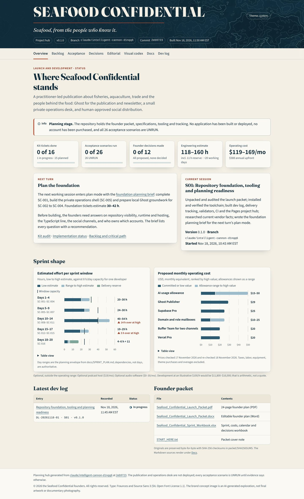
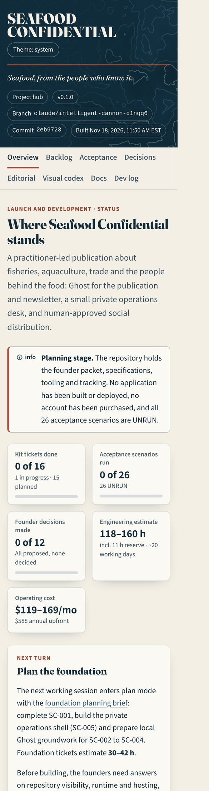
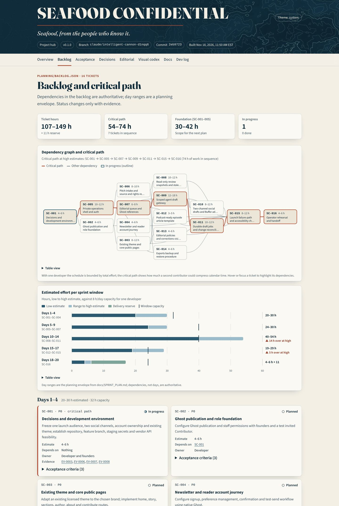
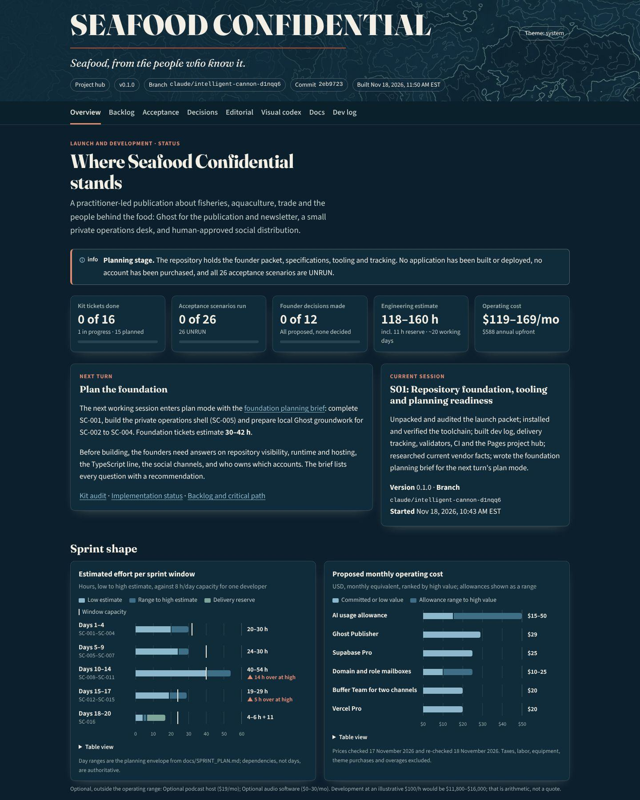

# Repository foundation, tooling and planning readiness

## Summary

The launch packet that arrived as a zip is now a working repository. The development kit sits at the root, and the founder originals are preserved with checksums. The tooling validates the kit's own consistency on every push. A dev log and an evidence-backed tracking system record every turn. A branded project hub publishes each branch to GitHub Pages. Every tool and dependency the foundation needs was installed and verified in this cloud environment, including local Supabase and local Ghost. Current vendor facts were researched, and several of them change the foundation design. The [foundation planning brief](../../docs/planning/FOUNDATION_PLANNING_BRIEF.md) is ready for the next turn's plan mode. **No application exists yet, and all 26 acceptance scenarios remain UNRUN.**

## What changed

**Packet and structure**
- The kit was unpacked at the root (32 files, byte-identical: EV-0001). The PDF, DOCX, XLSX and cover note sit in `packet/` with `SHA256SUMS`. The zip was removed from the working tree and is recoverable from `2eb9723`.
- The README keeps the original description and adds navigation. The kit README is preserved as `docs/DEVELOPMENT_KIT.md`. `AGENTS.md` and `CLAUDE.md` each gain an appended, dated conventions section; the kit's text is unchanged.
- SC-001 moved from `planned` to `in_progress`: repository, dev environment and vendor feasibility work started, founder decisions still outstanding.

**Tracking and validation**
- `devtrack/`: sessions, workstreams and append-only evidence, each with a JSON Schema. `devlog/`: this log. `docs/IMPLEMENTATION_STATUS.md` has a generated, deterministic status block, and CI fails when it is stale.
- `pnpm validate` runs 9 checks. They cover backlog integrity and CSV parity, the calendar, decisions, the acceptance matrix, the agent contract against 17 example requests, the fixture guard, packet checksums, Markdown links and the evidence rules. 26 tool tests prove the checks catch what they exist for.

**Environment and tooling (your mid-turn request)**
- `tools/bootstrap/install-dev-tools.sh` installs pinned tools and verifies each against a SHA-256 hash: actionlint 1.7.12, gitleaks 8.30.1, shellcheck 0.11.0, firebase-tools 15.36.0, vercel 66.1.0, gscan 6.7.0, and Node 24 LTS side-by-side.
- Repo dependencies are pinned exactly: Supabase CLI 3.2.0, Playwright 1.63.0, axe, Ajv, marked, yaml, Prettier and the OFL fonts. pnpm 12 runs with supply-chain gates.
- Docker is running with a registry mirror. Supabase local stack images, Ghost 6.78.0 and Mailpit are pulled and verified. A Next.js 16.4.6 probe with the foundation libraries builds, which also warmed the package store. glslang is installed for shader validation.

**Project hub and previews**
- `pnpm hub:build` produces 44 pages: overview, backlog with dependency graph and critical path, acceptance, decisions, editorial plan, visual codex, rendered docs, dev log and evidence. The masthead is a WebGL2 "bathymetry" contour field with fallbacks. The pages carry a strict CSP and `noindex`, and self-host their fonts.
- `.github/workflows/pages.yml` publishes every branch to `gh-pages/branches/<slug>/`, with a root index of previews and a `/latest/` redirect. `ci.yml` validates, tests, builds, lints, scans for secrets, validates the shaders, and uploads screenshots and axe results as artifacts.
- `brand/tokens.json` is the single source of brand colour roles. The build fails if a declared text pair drops below WCAG AA. A `sc-visual-codex` project skill encodes the system for future visual work.

**Planning**
- [Kit audit](../../docs/KIT_AUDIT.md): 17 findings, including the social-channel conflict, the agent contract gaps, the public-repository mismatch, tight capacity and the brand contrast facts.
- [Foundation planning brief](../../docs/planning/FOUNDATION_PLANNING_BRIEF.md): scope, current platform facts, verified feasibility, proposed architecture (middleware, telemetry, security, testing), 16 questions with recommendations, and a phase plan.
- [ADR-002](../../decisions/ADR-002-repository-foundation.md): the repository-scope engineering decisions.

## Decisions

| Decision | Rationale |
|---|---|
| Kit at the repository root | Every path inside the kit's documents stays valid |
| **Node 24 LTS, not 26** | Ghost 6.78 (`^22.23.5 \|\| ^24.22.3`) and gscan (`^22.17 \|\| ^24`) exclude Node 26 (EV-0009) |
| pnpm 12 with `allowBuilds`, a 1-day `minimumReleaseAge` and `trustPolicy: no-downgrade` | Supply-chain protection after the 2025 npm compromises; both gates proved their value in the probe (EV-0008) |
| Previews from a `gh-pages` branch rather than Actions artifacts | The Actions `github-pages` environment only deploys the default branch, which would block previews of unmerged session branches |
| **No Dependabot version-update PRs** | You work from the latest open PR, and bot PRs would pollute that list. Security alerts can stay on at the repository level |
| Interim proprietary licence | The founders own the material; open licensing is their decision (Q14) |
| Derived accessible colour steps | Rust on salt is 4.46:1 and sea glass on salt is 2.36:1; brand values stay unchanged |
| HTML/CSS bar charts | SVG text scaled down to about 9.5 px in two-column layouts; HTML keeps real type sizes |
| Product choices stay **Proposed** | Hosting, TypeScript line, Buffer path, telemetry backend and repository visibility are listed in the brief for the founders |

## Problems and resolutions

| Problem | Cause | Resolution |
|---|---|---|
| `docker pull` returned 429 Too Many Requests | Docker Hub's anonymous rate limit on the shared egress address | Registry mirror `mirror.gcr.io` in `/etc/docker/daemon.json` (EV-0004) |
| Ghost exited with "error code -97" | Ghost binds IPv6 `::` by default; the container has no IPv6 (EAFNOSUPPORT) | `server__host=0.0.0.0`; Ghost answered in about 4 s (EV-0007) |
| The Next.js template failed to install | pnpm's trust policy flagged `undici-types@6.21.0` via the template's `@types/node@^20` | Align `@types/node` with the runtime (`^24`) rather than weakening the policy |
| `@supabase/supabase-js` 2.119.1 refused | Published 14:42 UTC that day; under the 1-day release age | Use 2.119.0; the gate works as designed |
| The kit's CSVs would be rewritten | They use CRLF; the default `eol=lf` normalization would alter them | `*.csv -text` in `.gitattributes`; the ticket CLI preserves CRLF |
| Ajv strict mode rejected the kit's contract | `required` inside `if/then` without a redeclared property (valid JSON Schema) | Relaxed only `strictRequired`; noted as audit finding K-06 instead of editing the kit |
| axe: scrollable regions unreachable by keyboard | Wide tables and code blocks overflow on phones | Focusable named regions (WCAG 2.1.1) |
| axe: a swatch label at 2.87:1 | Ink on rust | Chip text is now chosen by computed contrast |
| Chart text too small or too large | SVG text scales with the viewBox | Bars rebuilt in HTML/CSS |
| 24 `<h1>`s on the launch-packet page | One top-level heading per PDF page | Multi-H1 documents are demoted under a single page title |
| Pages simulation failures | A fixed `../pages` worktree path; `hub:check` rejecting the intentional previews link | `mktemp` worktree; a single exemption via `build.json` (EV-0013) |
| **CI run 1 failed** in the tool bootstrap (actionlint not found) | `log()` wrote to stdout inside `fetch()`, whose output is captured as the download path; with a cold cache the log line corrupted the path, and `tar && install` hid the failure from `set -e` | Messages go to stderr, `inherit_errexit`, separate steps, a version check after every install; verified in a clean `ubuntu:24.04` container, including a negative run (EV-0015). Local runs had passed only because the cache was warm |
| Two skills cite files that don't exist | `shader-projects-assistant` and `dev-blog-automator` ship only SKILL.md (template TODOs remain) | Used Khronos `glslangValidator` instead; reported as an agent-setup improvement |

## Evidence

EV-0001 to EV-0016 are in [the evidence log](../../devtrack/evidence.json). All passed except EV-0009 and EV-0010, which are informational. EV-0015 records the CI defect found after the first push and its verified fix. EV-0016 records the first real Pages publication to `gh-pages`.

| Screens (final verification round, EV-0012) | |
|---|---|
|  |  |
|  |  |

The visual codex page is in [hub-visual-codex-desktop.jpg](../assets/2026-11-18-s01/hub-visual-codex-desktop.jpg).

## Risks and open questions

- **Founder decisions D01–D12 are all Proposed.** SC-001 can't complete without them.
- **The repository is public** while the kit assumes a private one (Q1). This decides the theme licence options and who can read the hub.
- **GitHub Pages must be enabled once** (Settings → Pages → `gh-pages` / root) before the previews are served.
- Platform changes since the packet affect SC-005, SC-009 and SC-010: Next 16 `proxy.ts`, Supabase keys and grants, and Buffer API-key posts bypassing approval.
- The workbook can't be regenerated here. The repository JSON is the working record until Q12 is decided.
- Docker is not running by default in new cloud sessions, and pulled images don't persist when the container is reclaimed.

## Next actions

1. Enable GitHub Pages from the `gh-pages` branch, then open the preview from the PR.
2. Founders: answer the questions in the planning brief, at minimum Q1 to Q4 and Q8 to Q9, plus decisions D01, D04, D05, D06 and D10.
3. Next turn: plan mode on the brief, then build foundation phases F0 to F2 (desk scaffold, database with grants, RLS and pgTAP) on a new session branch.
4. Optionally save the environment setup script so new cloud sessions start with these tools.
5. Agent setup: merge the `sc-visual-codex` entry into your shared visual codex skill, which isn't installed in this cloud environment, and complete the shader and dev-blog skills' missing scripts and references.
