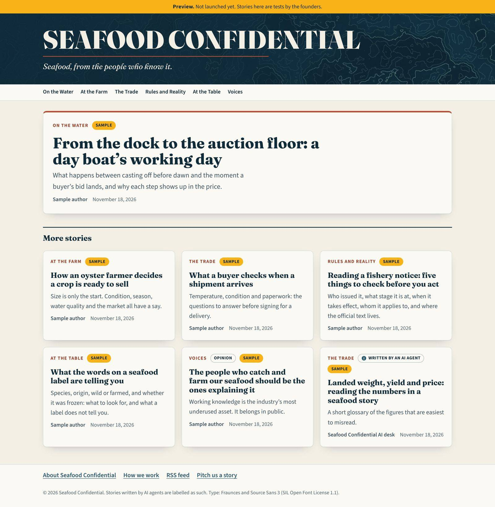
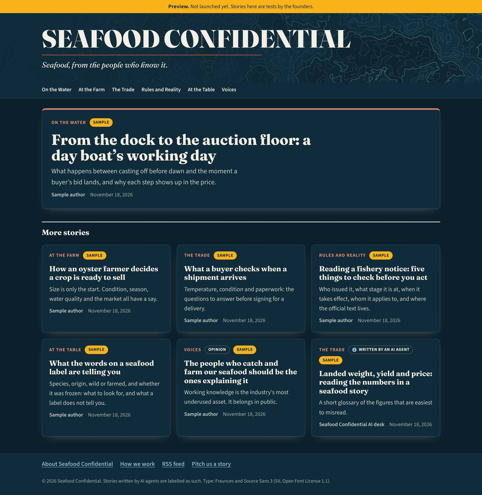
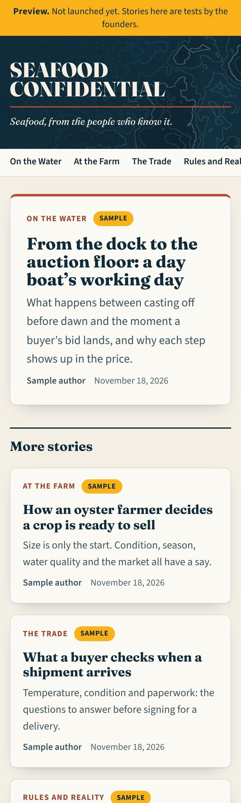
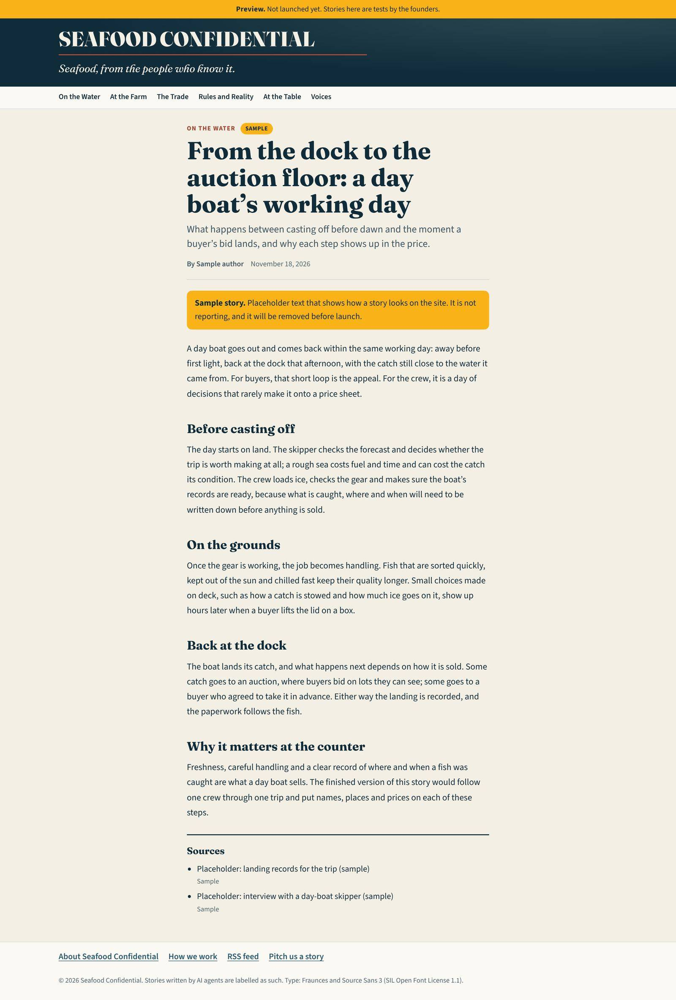
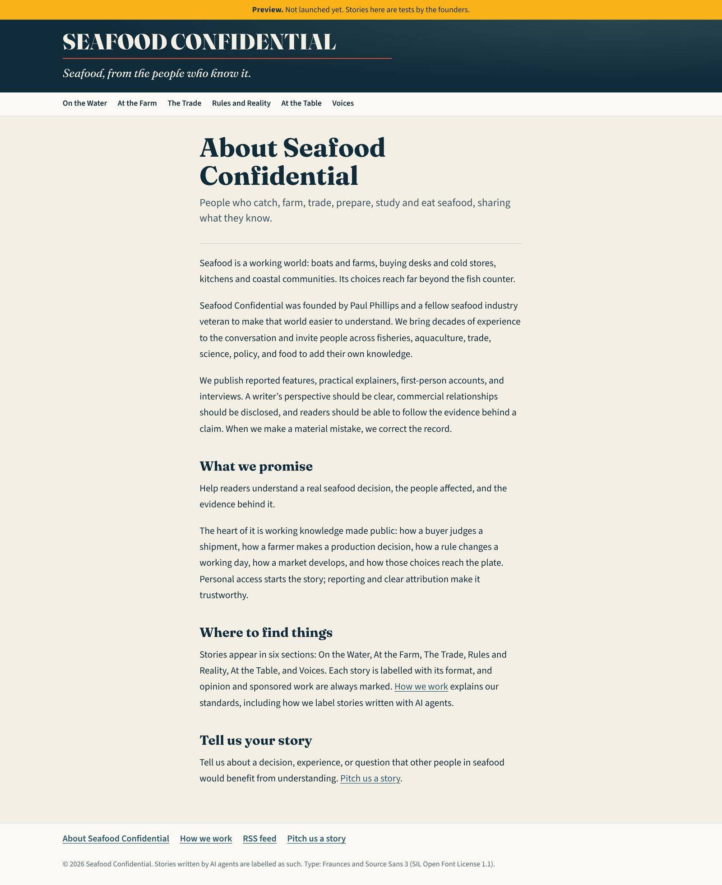
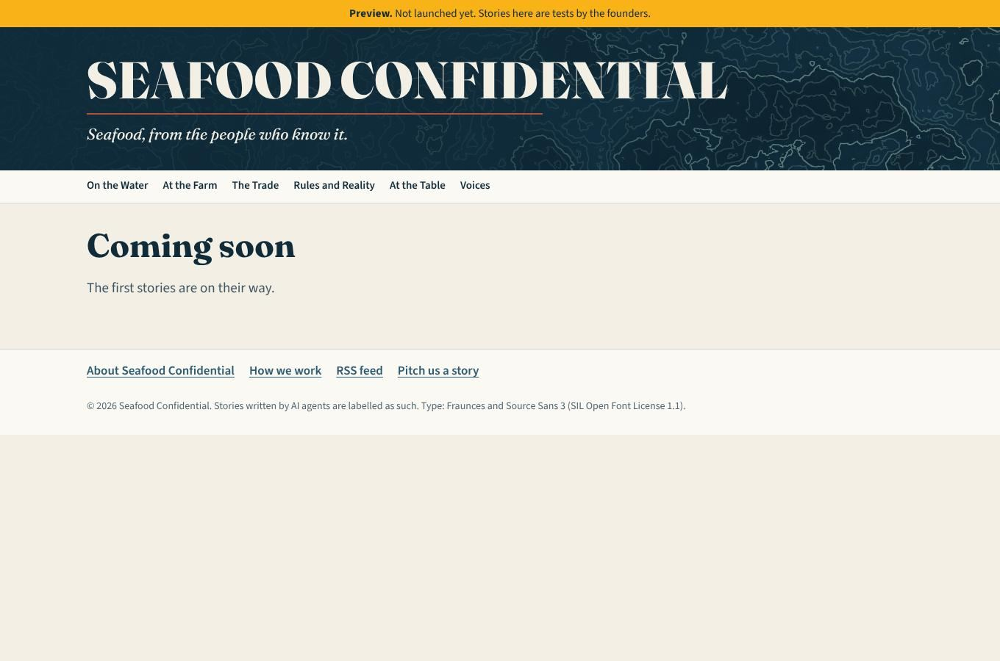

# Sample stories, standing pages and a publishing sweep ready for a scheduler

## Summary

Paul asked to "continue where it makes sense to enhance this and get some sort of working articles and placeholder stuff up". The preview site at https://seafood-confidential-preview.web.app now has:

- **seven sample stories**, one per section plus an explainer labelled as written by an AI agent. Each is clearly marked as placeholder text, not reporting;
- **About** and **How we work** pages, drafted from the founders' own brand guide and editorial playbook.

The desk (v0.6.0, revision `sc-desk-00003-jpq`) also gained a **publishing sweep** endpoint. It runs publish jobs left waiting, and accepts only a Google-signed token from one service account. The Cloud Scheduler job that would call it was **not** created; that is Paul's decision (see Decisions).

What has not run live yet:
- a publication by the desk service itself on Cloud Run. The samples went live through the same publishing code run by an operator. The safe first test is pressing "Update the published story" on any sample;
- the sweep with a real scheduler token;
- a real-email sign-in and the newsletter (unchanged from turn 5).

## What changed

**Code** (v0.6.0, all tested):
- **Sample stories.** Migration `20261119090000_sample_stories.sql` adds `editorial_items.is_sample`.
  - A trigger refuses every API role (`anon`, `authenticated`, `desk_agent`, `desk_publisher`, `desk_app`), so only an operator can mark or unmark a sample.
  - The site snapshot carries the flag.
  - The site builder labels samples everywhere: a "Sample" chip, an amber note on the page, and "Sample:" in feed titles.
  - The builder **refuses to build a site that is not a preview** while any sample is live.
  - In the desk, samples get a badge, and their next action is "Sample: nothing to do".
- **Sample content.** `supabase/sample/preview-content.sql` (idempotent) loads seven stories across every section and format, including an opinion piece and an AI-labelled explainer.
  - Sources are clearly marked placeholders.
  - The samples are attributed to an inert "Sample content (preview)" identity: agent-kind, with no token, grants or scopes.
  - It queues one publish job per story.
  - `remove-preview-content.sql` takes them down in two passes. After this turn's rehearsal, it also prints what to do next for each sample.
- **Standing pages.** Each Markdown file in `apps/desk/site-src/pages/` (front matter: title, description, order) becomes a page.
  - Pages are linked from every footer and listed in the sitemap.
  - `{{pitch_url}}` is filled in with the pitch form's address.
  - Names that collide with site paths are refused.
- **Story text.** Headings start at h2 whatever level the writer used, with no skipped levels. Same-site links are allowed (never `//host`), and only external links get `rel="nofollow"`. Titles and summaries get typographic apostrophes.
- **Publishing sweep.** `POST /api/publishing/sweep` runs up to ten waiting jobs.
  - It verifies a Google-signed ID token with `jose` 6.2.17: RS256 with Google's published keys, the exact audience, the configured account with a verified email, at most an hour old.
  - It answers 404 unless `PUBLISH_SWEEP_INVOKER` is set.
  - Refusals are logged with a reason class and the request ID, never the token.
- **Repository checks.** The link validator skips the public-site pages, and the file walker skips the generated site output.

**Live** (Paul's Supabase and Google Cloud projects):
- **Database.** The sample-stories migration was applied through the Management API in one transaction and recorded in the CLI's history.
- **Desk.** Image built by Cloud Build from an exact `git archive` of 84a1622; Cloud Run revision `sc-desk-00003-jpq` with `PUBLISH_SWEEP_INVOKER` set.
- **Caller account.** Service account `sc-desk-scheduler` created with no roles.
- **Samples.** Loaded, then published one by one by an operator run of the desk's own steps: claim, snapshot, build, Firebase Hosting deploy, complete. That made seven releases, of 24 to 30 files.

**Docs:**
- `docs/LAUNCH_PREVIEW.md`: samples and standing pages, step-by-step removal, the sweep (ready, not scheduled, with the command to turn it on), what runs where, what was verified for v0.6.0, the safe first test, costs, teardown and next steps.
- `docs/DESK.md` and `docs/DEPLOYMENT.md` brought to v0.6.0: preview mode, standing pages, samples, and the sweep's settings and scheduler commands.
- CHANGELOG [0.6.0]; `.env.example`.

## Decisions

- **Samples are a guarded, first-class flag, not ad hoc test stories.** The preview shows the real pipeline at work, and two independent guards keep samples off the real site: the database trigger and the builder's refusal.
- **Placeholder text makes no factual claims.** No figures, names, quotations or real sources: the kit forbids fabricated sources and quotes, so the samples show form, not facts.
- **Never attributed to a person.** The identity rule requires human principals to have a sign-in account, so the sample identity is agent-kind and has nothing it can do. Its jobs take the operator path: these are deliberate operator loads, not agent requests.
- **Standing pages live in the repository as Markdown.** They change rarely, need founder approval and benefit from review in pull requests. They are drafts from the brand guide, the editorial playbook and ADR-005, for the founders to approve.
- **The sweep authenticates with Google's OIDC, not a shared secret.** There is no secret to store or rotate, the calling account holds no roles, and the exact audience stops a token for another service being replayed here.
- **The Cloud Scheduler job is Paul's decision.** The session's safety policy refused to create a standing automation on his account. That is right: a job that runs every 15 minutes is ongoing behaviour, and it keeps the free Supabase project from pausing. The docs give him one command.
- **The samples were published by an operator run.** Signing in as Paul is not possible from the session, and an admin-generated sign-in link for a temporary account was refused in turn 5. So the same publishing code ran with a short-lived token instead, and the Cloud Run path is listed as not yet exercised.

## Problems and resolutions

- **The first draft of the docs said the scheduler job existed.** It was written before the job's creation was refused. It was corrected before commit: the sweep section, the "What runs where" row, the CHANGELOG, teardown and costs now say what is true. The "What runs where" heading, lost in an earlier edit, was restored.
- **The removal path had never run.** It was rehearsed end to end locally (EV-0055): publish seven, remove, run the queue, withdraw. It works. Pass 1's output ("published" seven times) gave no hint of the next step, so the script now prints a `next_step` column.
- **An evidence record overstated a probe.** The live "forged token" was an HS256 token with a dummy signature, not RS256. The record was corrected, and a stronger probe was added: an RS256 token from a key Google never issued, with every claim right. The desk refused it with `ERR_JWKS_NO_MATCHING_KEY`, which can only happen after it has fetched Google's signing keys. That also showed Cloud Run can reach them.
- **"Edit the page and the next publication carries it" was wrong.** Standing pages are built into the desk's image, so a change needs a redeploy. The docs now say so.
- **The local desk build predated the version bump.** Its footer said v0.5.0, while the live desk reported 0.6.0. It was rebuilt, and every suite re-ran on the final tree with exit codes captured.
- **Earlier in the turn:**
  - The sample identity first failed the principal identity rule (human principals need a sign-in account), so it became agent-kind.
  - `app.next_content_id()` refuses non-staff sessions, so the loader uses the same counter directly.
  - The link validator failed on the new site pages, which link to site addresses rather than repository files. That slipped into commit 3c99309 because a pipe hid the exit code; it was fixed in 84a1622. This turn's final gates were run with their exit codes captured.
  - Docker stopped after a session restart and was restarted.

## Evidence

- **EV-0051:** the migration applied to hosted Supabase; desk revision `sc-desk-00003-jpq` reports 0.6.0.
- **EV-0052:** the live sweep refuses a missing token, an HS256 token and a non-Google RS256 token (401), and GET (405). The log shows reason classes only.
- **EV-0053:** seven labelled samples and both pages are live; 0 axe violations and no horizontal overflow on ten views.
- **EV-0054:** pgTAP 238/238, Vitest 114/114, Playwright 31/31, `pnpm check` and the bundle scan, all with exit code 0. CI is green on 84a1622.
- **EV-0055:** the sample lifecycle rehearsed locally: load, publish, remove, withdraw.
- **EV-0056** (observation): the Cloud Scheduler job is not created, and Cloud Run publishing has not run.
- **EV-0057:** an owner updating a live sample republishes it with nothing visible changing. This is the suggested first live test.

## Risks and open questions

- **The first publication by the desk on Cloud Run is untested.** It is low risk: the deploy code has released the site nine times with another token, and the runtime account has the role it needs. A failure shows on `/publishing` with the reason, and the job can be retried.
- **The Free-plan project can pause.** Without the sweep job, a week with no use pauses Supabase, and the desk then fails until the project is restored from the dashboard. Turning on the sweep keeps it awake.
- **Placeholder copy on a public address.** The samples are labelled, and the site is `noindex` and `Disallow: /`, but anyone with the link can read them. Every sample says it is not reporting.
- **The About page names Paul**, from the brand guide's About introduction, and refers to "a fellow seafood industry veteran". The founders should approve the wording, and decide whether to name Dave, before launch.
- **On phones, the section bar scrolls sideways.** The only hint is a cut-off label; consider a fade at the edge.

## Next actions

1. **Paul, security** (from turn 5):
   - delete the exposed Supabase secret key `seafood_confidential_launch`;
   - rotate the Google Cloud key (ID starting `3b4c8ef7`);
   - revoke the Supabase access token when done.
2. **Paul, first live run:** sign in (same browser), then open any sample and press "Update the published story".
3. **Paul, optional:** turn on the publishing sweep with the one command in `docs/LAUNCH_PREVIEW.md`.
4. **Founders:** approve or rewrite the About and How we work drafts, and invite Dave (Supabase organization, then his desk account).
5. **Before real stories go out:** remove the samples (two passes of the removal script with a button press between).
6. **Carried over:** custom SMTP on our own domain, an "Add a staff member" screen, and CI deploys with Workload Identity Federation.
