# Story images, a motion and depth system for the public site, and an upload fix found by red-teaming the live configuration

## Summary

Paul asked for photographs, GSAP scroll dynamics, style improvements and "massive tightening", neo-skeuomorphic depth, more parallax layers, and text and image motion that is cohesive and can be retuned. (GSAP is the GreenSock animation library; ScrollTrigger is its scroll-driven part.) Live now at https://seafood-confidential-preview.web.app:

- **Photographs.** Six sample stories carry public-domain photographs, each credited under its picture.
- **Motion.** Layered parallax. Titles and images animate in, and reverse when the reader scrolls back.
- **Depth.** Raised and recessed surfaces, lit from one direction.
- **Tuning.** Everything is set from the design tokens, with three presets, and readers have a switch to turn animation off.
- **Lead images in the desk.** Any story can have a lead image, tied to a cleared rights record. Agents still never publish images.

**Red team.** Testing the desk's own container with Cloud Run's limits found that a large photograph would have crashed the live desk, and that uploads over 10 MB failed. Version 0.7.1 fixes both, names HEIC files, and closes a font caching gap. The live desk now runs with 1 GiB (revision `sc-desk-00005-dw7`).

**Not yet run live:**
- an upload through the live desk;
- a publication by the live desk itself (the samples were published by an operator run of the same code).

## What changed

**Public site (v0.7.0; `apps/desk/site-src/`, `src/lib/site/build.ts`):**

- **Photographs:**
  - `<picture>` with AVIF first and WebP as the fallback, at 480 to 2400 px, cropped around a focal point set by CSS classes (the strict CSP allows no inline styles);
  - a wide hero with caption and credit, and image cards;
  - a drawn plate of the section for stories without an image;
  - `og:image` for previews on social media.
- **Motion** (GSAP 3.15.1 with ScrollTrigger, self-hosted; `site-src/motion.js`):
  - parallax masthead layers: bathymetry, contour linework, light and type;
  - titles rising word by word, with their exact text kept for screen readers;
  - images opening from the edges and developing into colour;
  - reveals that reverse on scroll-back, section rules that draw, a reading-progress bar, and a lead panel that leans toward the pointer.
- **Retuning and turning it off:**
  - `SITE_MOTION` picks `calm`, `standard`, `expressive` or `off`, from the motion tokens.
  - The footer switch is remembered, and `prefers-reduced-motion` turns motion off.
  - Every page is complete without JavaScript, with a 2.5-second failsafe if the script never arrives.
  - Turning motion off restores the server's HTML exactly.
- **Depth and tightening:**
  - Design tokens v0.2 add `space`, `radius`, `elevation` (per theme, one light from above) and `motion` (durations, easings, distances, parallax depths, presets).
  - The stylesheet was rewritten on them: a tighter type scale, a breakout grid, raised cards and lead panel, recessed sources, bevelled chips, a sticky frosted section bar that marks the current section, faded edges on the phone navigation, an ink footer, and print styles.
  - The contour linework is generated by a seeded script (`scripts/build-contours.mjs`).

**Desk (v0.7.0):**
- **Lead image card.** It sits on the story page, with a preview, rights status, alternative text, caption, credit and focal point.
- **Uploads** go through a route handler (`/stories/<id>/image`) that checks the session, origin and size before reading the body.
- **Processing.** sharp, a wrapper for the libvips image library, makes the AVIF and WebP renditions. It applies EXIF orientation and removes all metadata, location included.
- **Operator CLI:** `pnpm --filter @sc/desk images`.

**Database** (migration `20261119120000_story_images.sql`, 34 new pgTAP tests):
- **Storage.** `app.story_images` holds each image, tied to a rights record of the same story. Renditions and originals sit in private tables reached only through checked functions.
- **Publishing.** Publishing pins the image, and `app.site_media` hands the publisher the files under the job's claim token.
- **Agents.** The agent gate `no_images` keeps them away from stories with images.
- **Security fix.** API roles can no longer insert a story with publication fields set.

**v0.7.1, from the red team below:**
- **Memory-bounded image processing:**
  - one upright master the size of the largest rendition (JPEG and WebP shrink while decoding);
  - the largest rendition capped at 2400 px and about 4.3 megapixels;
  - one image at a time per server, with libvips' cache off;
  - `MALLOC_ARENA_MAX=2` in the image.
- **Upload size.** `proxyClientMaxBodySize` is 16 MB, so the advertised 15 MB limit is real.
- **HEIC.** HEIC photographs get a message saying what they are and how to export them.
- **Asset caching.** The asset build versions every file the stylesheet loads by content, and the font preload uses the same address.
- **Memory.** The live service runs with 1 GiB.

**Live** (Paul's Supabase and Google Cloud projects):
- **Database.** The migration was applied through the Management API in one transaction, with its history record, and grants were checked.
- **Desk.** v0.7.0 went live as revision `sc-desk-00004-79x` (Cloud Build from `git archive` of c0f06c7), then v0.7.1 as `sc-desk-00005-dw7` (b99e04c, `--memory 1Gi`).
- **Photographs.** Six were attached on the hosted database (10 renditions each, hashes re-checked inside the database). Six republish jobs pinned them; the last release has 95 files, 60 of them image renditions.

**Docs:**
- ADR-006 (Proposed);
- CHANGELOG 0.7.0 and 0.7.1;
- `docs/DESK.md`, `docs/DEPLOYMENT.md` and `docs/LAUNCH_PREVIEW.md`, including memory and upload limits;
- `THIRD_PARTY_NOTICES.md`: GSAP's licence, each photograph's source and licence, sharp and libvips;
- the sc-visual-codex skill's new "Motion and depth" section, reusable for later projects.

## Decisions

- **Images live in the desk database for now (ADR-006, Proposed).**
  - A publication reads text and images in one claim-fenced transaction.
  - The desk needs no storage credential, and no public bucket exposes unpublished images.
  - Backups stay one system.
  - The ADR names when to move renditions to Cloud Storage: a 2 GB database, or builds loading more than about 200 MB of images.
- **One lead image per story, tied to a rights record, pinned at publish.** What is live is what was published, for images too, and agents never publish a story with an image. This follows ADR-005 and the playbook's image rules.
- **GSAP, self-hosted, under Webflow's no-charge Standard licence.**
  - It is not open source. Its terms allow this commercial use, require the notices to stay intact, and can change.
  - Nothing on the site depends on it to be read, so CSS scroll-driven animation is a fallback if the terms change.
- **Sample photographs are U.S. government works and a Library of Congress dedication.**
  - Every licence was checked on its Commons file page, not inferred.
  - Each picture's credit names the agency or photographer.
  - The AI-written sample has no photograph.
- **The live desk gets 1 GiB.** The fixed code passed with 512 MiB, but the server's high-water mark reached 509 MiB, and Cloud Run also holds site build files in memory. At preview traffic 1 GiB stays inside Cloud Run's free tier.
- **The fixes ship as 0.7.1, not a rebuilt 0.7.0.** A 0.7.0 build was already live, and each version should name one build.

## Problems and resolutions

**Found by red-teaming the live configuration (v0.7.1):**
- **A 24-megapixel photograph would have crashed the live desk.**
  - The desk's own container ran with Cloud Run's limits (512 MiB, one CPU), and photographs were uploaded through the real route.
  - v0.7.0 peaked at 483 MiB on a 12-megapixel phone photograph and was killed for running out of memory on a 24-megapixel one (EV-0064). Every rendition was decoded from a full-size copy.
  - With the rewrite, 12 to 59 megapixels attach, one at a time and two at once (EV-0065).
  - This is now the standard check for anything memory-heavy in the desk.
- **Uploads over 10 MB were refused as "unreadable".** Next.js's proxy layer buffers request bodies and silently cuts them at 10 MB; its log said so. The limit is now 16 MB.
- **HEIC photographs were called damaged.** sharp's bundled library has no HEIC decoder. The header check now names the format.
- **Fonts and the contour art could stay stale for a year after a change.** They are served `immutable` under unversioned names. Now each file the stylesheet loads carries a content version. A browser check confirmed one font request and no unused-preload warning.

**Found by the test suites (v0.7.0):**
- **Postgres and the database tests:**
  - postgres.js double-encoded the renditions' JSON (`cannot get array length of a scalar`); it now uses `tx.json()`. The refusal mapping was narrowed so a fault on our side is not shown as a rights problem.
  - Attaching an image was refused while any publish job was queued; it now waits only for a job that is running.
  - The private image tables lacked Row Level Security; it is on, and pgTAP checks it.
- **The public site:**
  - Split headlines duplicated their text for assistive technology; the words are now split with no hidden copy.
  - Axe saw low contrast in the middle of an animation; the accessibility helper waits until GSAP is idle, which is how a reader sees the page.
  - Turning motion off left a `scale(1.16)` on pictures; the switch now removes every style it added.
- **Playwright tests:**
  - The AI label assertion matched related-story cards; it is scoped to the article.
  - A publish confirmation raced the result.
- **Tooling:**
  - The operator CLI could not run under Node's type stripping (a constructor parameter property).
  - The Management API refuses SQL bodies over about 3 MB, so the CLI writes base64 and leaves out a master that would not fit.

**Sourcing the photographs:**
- Wikimedia's rate limit (HTTP 429) on originals was avoided by using its standard thumbnail widths.
- Three candidates were too small, and the thumbnailer would have upscaled them; they were replaced.
- Links missing the `File:` prefix were corrected in the manifest, the notices and the database.

## Evidence

- **EV-0058:** v0.7.0 locally: pgTAP 272/272, Vitest 126/126, Playwright 32/32, `pnpm check`, bundle scan. CI green on c0f06c7.
- **EV-0059:** local site audit: 11 views, 0 axe violations, no overflow. Reduced motion, no-JS and the switch all work.
- **EV-0060:** migration applied to hosted Supabase. Desk v0.7.0 live; image route 401 without a session, 403 cross-origin.
- **EV-0061:** six photographs attached on hosted Supabase, and the site rebuilt with them (95 files, 60 renditions).
- **EV-0062:** live audit: 11 views, 0 axe violations. `/media` served immutable with the site's CSP.
- **EV-0063** (observation): an upload and a publication by the live desk had not run yet.
- **EV-0064** (fail, defect IMG-0001): the v0.7.0 container was killed by a 24-megapixel upload, and uploads over 10 MB were cut off.
- **EV-0065** (pass, IMG-0001 fixed): the v0.7.1 container attaches 12 to 59 megapixels, and two uploads at once, under 512 MiB.
- **EV-0066:** v0.7.1 tree: pgTAP 272/272, Vitest 131/131, Playwright 32/32, `pnpm check`, bundle scan, and a single font request.
- **EV-0067:** live page weight on a cold cache:
  - 383 to 532 KB per page, and 755 KB for the iPhone home page;
  - LCP (largest contentful paint) 0.38 to 1.2 s;
  - CLS (layout shift) at most 0.022.
- **EV-0068:** desk v0.7.1 live with 1 GiB, with probes.

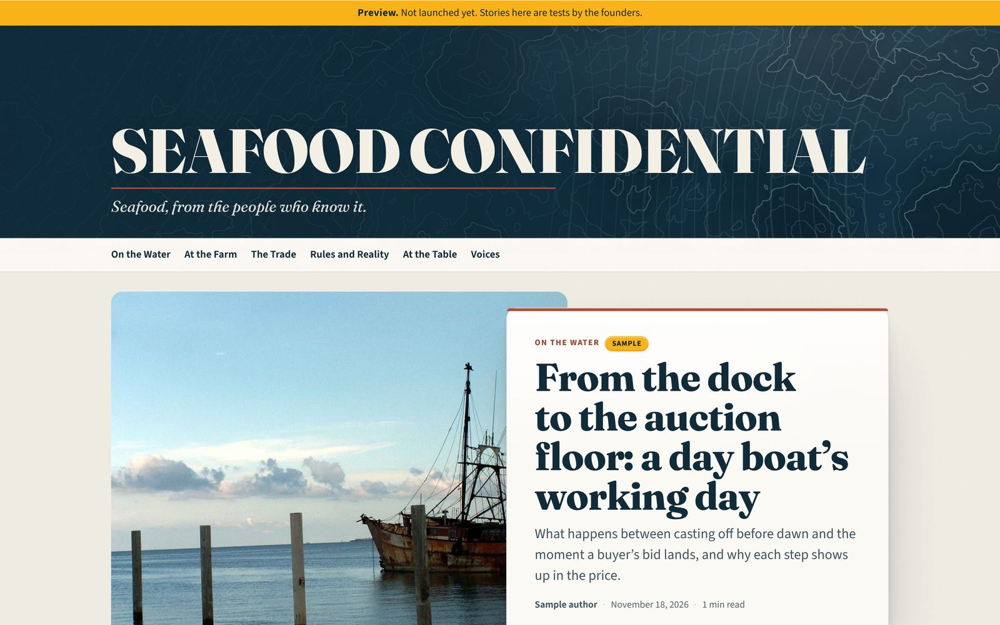

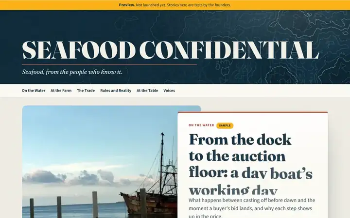

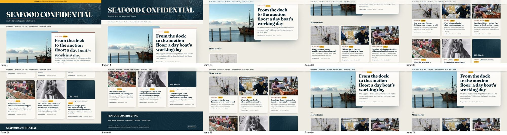

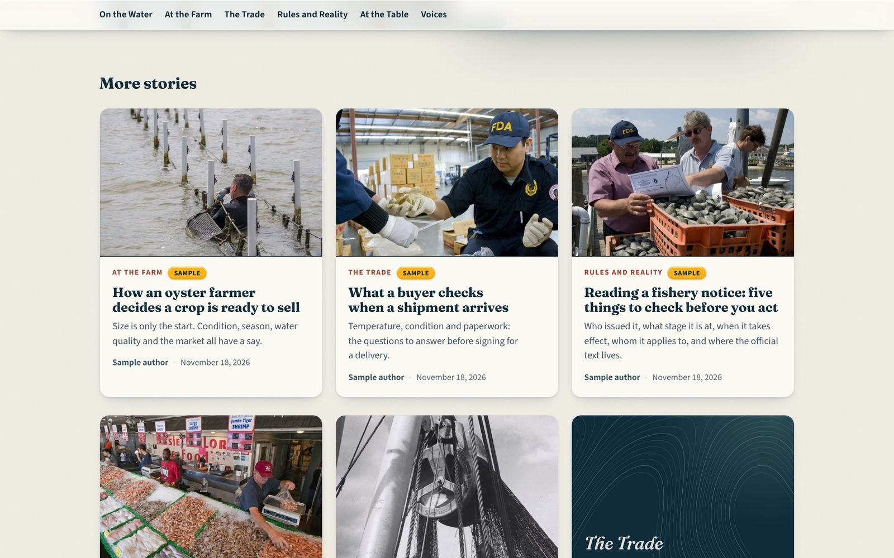

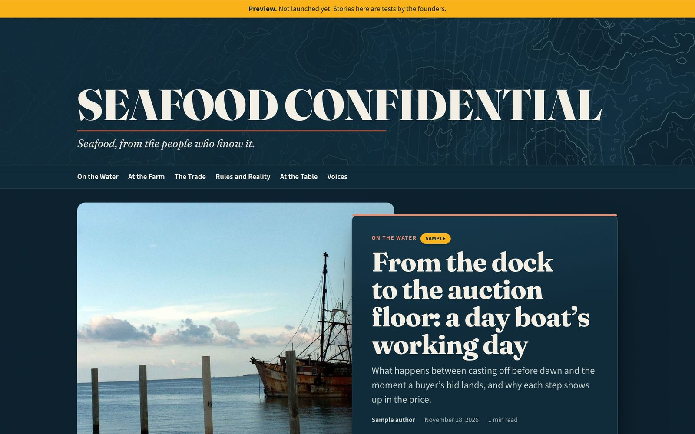

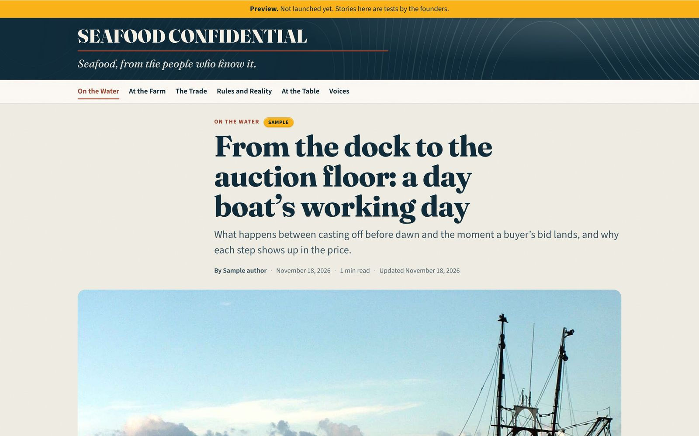

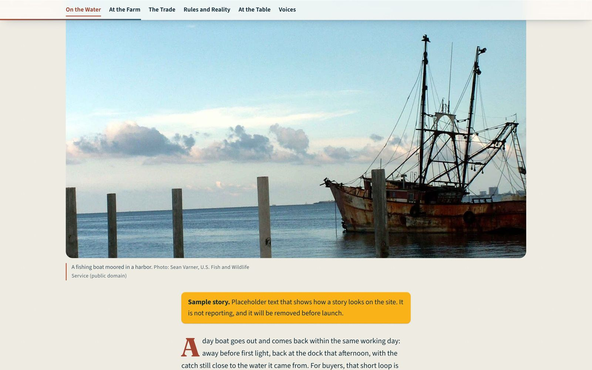

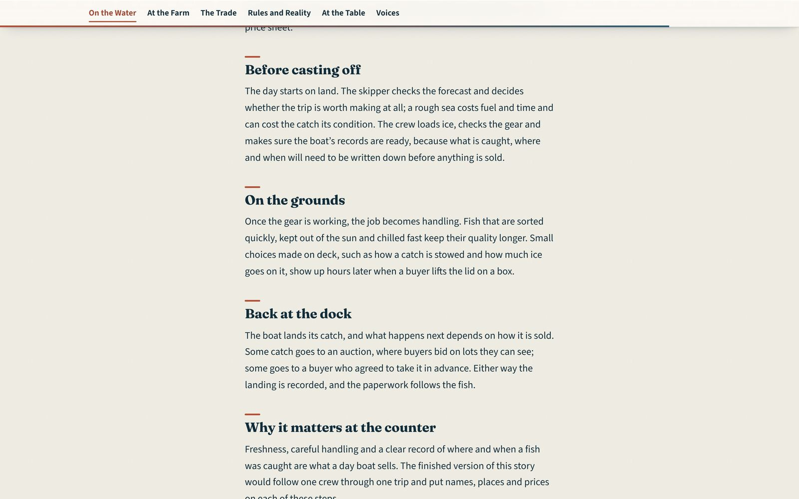

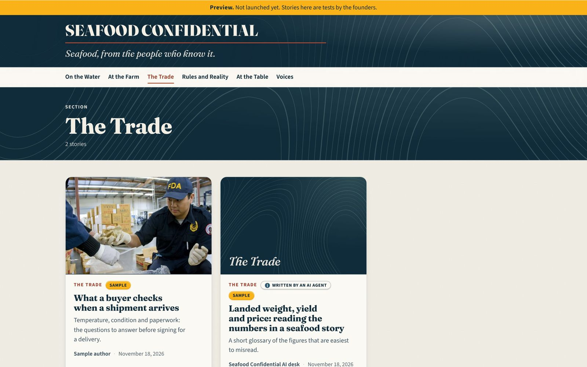

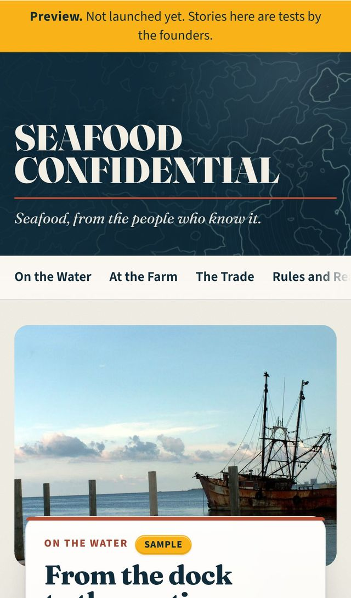

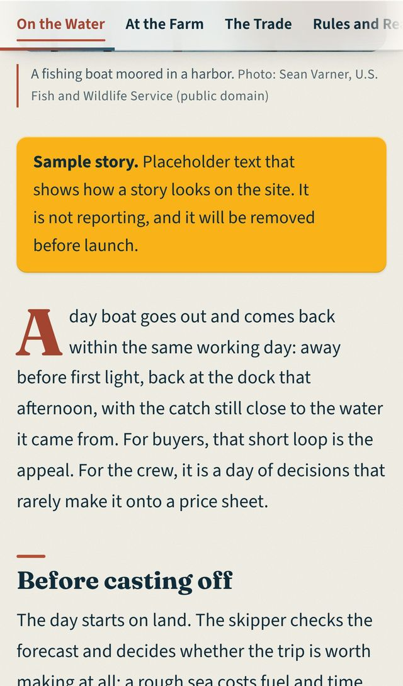

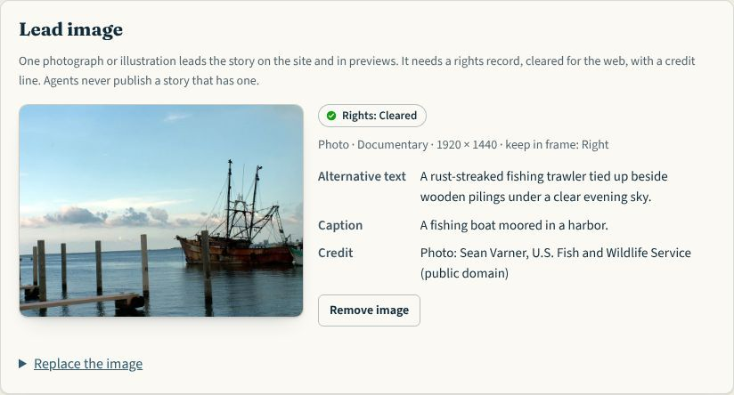

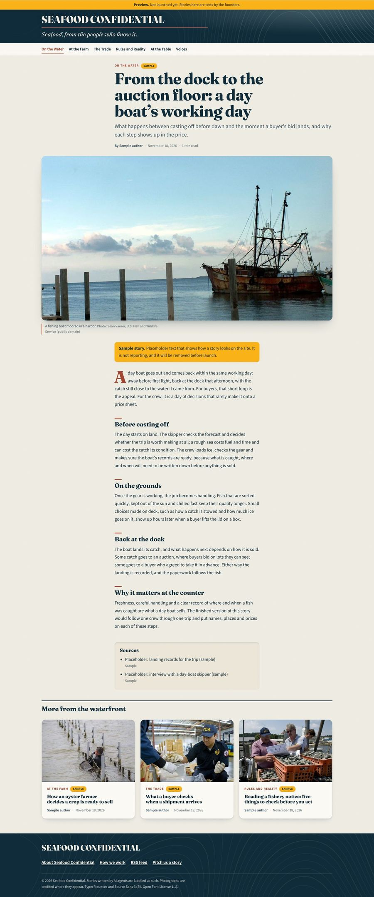

## Risks and open questions

- **Upload and publication by the live desk are still untested.**
  - Each was tested end to end locally.
  - The upload was tested in the desk's own container with Cloud Run's limits.
  - The publishing code has released the live site with an operator token.
  - Paul's first update or upload is the first live run, and a failure shows on the story or Publishing page with its reason.
- **GSAP's licence can change.** It is proprietary and free of charge under Webflow's terms; the site does not depend on it to be read.
- **Images make the database grow.** ADR-006 names the review points. Today every build reads every published image; Firebase uploads only new ones.
- **Processing takes 20 to 60 seconds on one CPU.** The form says so. A lower AVIF effort is the first lever.
- **Portrait photographs top out at about 1,700 px wide** to bound memory. On a large high-density screen a portrait hero, cropped to landscape, is a little soft.
- **Fonts are the largest item on a first visit (296 KB).** The Fraunces files carry four variation axes, two of which (`SOFT`, `WONK`) the site pins at zero. Its optical-size-and-weight files would cut the two faces from 271 KB to 149 KB.
- **The live site picks up the versioned font and contour addresses at its next publication.** Until then it behaves as before.
- **ADR-006 is Proposed.** The founders should confirm images in the database and the GSAP licence.

## Next actions

1. **Paul, security** (carried from turn 5):
   - delete the exposed Supabase secret key `seafood_confidential_launch`;
   - rotate the Google Cloud key whose ID starts `3b4c8ef7`;
   - revoke the Supabase access token when done.
2. **Paul, first live run:**
   - sign in, in the same browser;
   - open any sample and press "Update the published story". That also carries the versioned assets to the live site;
   - then try a photograph: add a rights record first, then use "Lead image".
3. **Founders:** confirm ADR-006, approve or rewrite the About and How we work drafts, and invite Dave.
4. **Optional:** turn on the publishing sweep (one command in `docs/LAUNCH_PREVIEW.md`).
5. **Before real stories go out:** remove the samples and their photographs (two passes of the removal script).
6. **Later:**
   - the smaller Fraunces files (271 KB to 149 KB on a first visit);
   - moving image processing to a job if uploads become frequent;
   - carried over: custom SMTP, an "Add a staff member" screen, and CI deploys with Workload Identity Federation.
