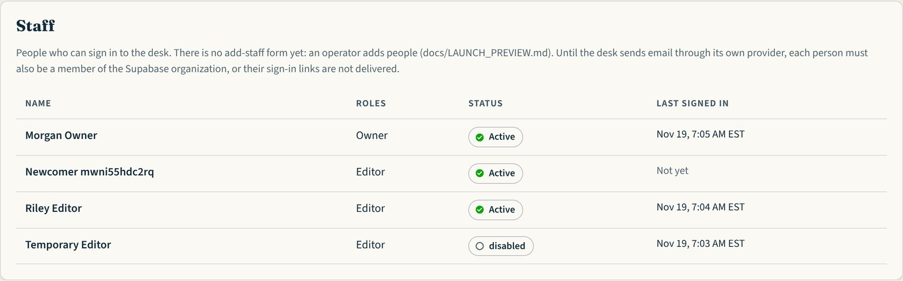

# Dave's owner account, and owners can see who has signed in

## Summary

Paul asked to continue development and to get Dave signed up for his owner slot.

**Dave Simpson now has an owner account on the live desk:** a confirmed sign-in identity, his desk record and the owner role. It was checked the way the desk checks access, so the desk has two owners.

**One step remains, and only Paul can take it.** Supabase's free mailer emails only members of the Supabase organization, and its API cannot send that invitation. Paul invites Dave in the Supabase dashboard; Dave accepts, then signs in.

**Owners can watch for it.** In version 0.7.3, Settings under Staff shows owners when each person last signed in, or "Not yet". It is live on the desk.

**Also confirmed live:** Paul's first real-email sign-in happened on the evening of 18 November. A publication by the desk on Cloud Run is still untested.

## What changed

- **Live operation (no repository change):** Dave's account was created as Paul's was in turn 5.
  - **Identity:** Supabase's Auth admin API, using the project's secret key read into memory for one call and never printed or stored.
  - **Desk record:** one SQL transaction for the principal and the owner role, as `scripts/staff.ts` does.
  - **Display name:** "Dave Simpson", inferred from his address; Paul can correct it.
  - **Privacy:** his address is not recorded anywhere in the repository.
- **Database:** migration `20261119140000_staff_sign_ins.sql` adds `app.staff_sign_ins()`.
  - It is a security-definer function returning each human principal's last sign-in, to owners only. Anyone else gets no rows.
  - Only that one value leaves the auth schema.
  - It is executable by signed-in staff, not by the public, agents or the publisher.
  - It is applied live with its migration-history record (five migrations recorded).
- **Desk, Settings, under Staff:**
  - owners get a "Last signed in" column ("Not yet" until someone's first sign-in);
  - a disabled member reads "Disabled";
  - the card's note no longer mentions Ghost (ADR-005 replaced it), and says how people are added and that each person must be a Supabase organization member until the desk sends its own email.
- **Tests:** 10 pgTAP tests (shape, grants, owners see everyone including people who have never signed in; editors and disabled owners see nothing). One end-to-end test: a new member shows "Not yet", the signed-in owner a time, and editors do not get the column.
- **Docs:**
  - `docs/LAUNCH_PREVIEW.md`: both founders have owner accounts, Paul's three-step invitation with role guidance, how to add someone else, and real-email sign-in marked done;
  - `docs/DESK.md`: a Staff section;
  - CHANGELOG 0.7.3.
- **Live:** desk v0.7.3 on revision `sc-desk-00007-nhx` (1 GiB).

## Decisions

- **Create the account now; leave the Supabase invitation to Paul.**
  - The Management API can list organization members but cannot invite them.
  - An invitation grants dashboard access, so it is Paul's to send in any case.
  - The organization holds only this project, so the docs give both options: Owner if Dave should co-own the infrastructure, Read-only if he only needs the desk.
- **Do not test his sign-in by sending a link.** The mailer would refuse his address today, the project's two-an-hour quota is shared, and a link requested by this session would not open in Dave's browser. Dave's own first sign-in is the test.
- **Show sign-ins to owners only, and only the time.** That is what onboarding needs, and nothing else from the auth schema leaves it. Editors see the same staff list as before.
- **No self-service "add staff" form yet.** Creating sign-in identities needs either a secret key in the desk, which ADR-003 rules out, or open sign-ups with an invitation check. And while the free mailer only reaches organization members, every new person needs Paul's invitation anyway. So it belongs with custom SMTP, as one decision.

## Problems and resolutions

- **The Docker daemon stopped while the session was paused, twice.** The first restart was tied to the shell that started it. It now runs detached in its own session, and the local Supabase containers came back on their own.
- **The new column showed times "in the future".** It did not: the session had been paused for several hours, and the clock was right. The release and account dates in the docs were corrected from 18 to 19 November.
- **A first query used a wrong table name** (`publishing_settings`) and failed harmlessly inside a rolled-back check.

## Evidence

- **EV-0073:** Dave's owner account on the live desk. With his identity bound, he is staff and owner, and sees 7 stories and 14 publish jobs. The desk has 2 active owners.
- **EV-0074** (observation): Supabase refuses to email addresses outside the organization's team, sends at most 2 emails an hour, and has no API to send invitations. The organization holds only this project.
- **EV-0075:** pgTAP 282/282, Vitest 132/132, Playwright 33/33, `pnpm check`, bundle scan.
- **EV-0076:**
  - the migration and grants are live;
  - an owner sees Dave as never signed in, and Paul as signed in at 02:51 UTC on the 19th;
  - a non-staff identity gets nothing;
  - desk v0.7.3 is live;
  - all publish jobs since are operator runs.

## Risks and open questions

- **Until Paul invites him, Dave cannot sign in.** If he tries, the desk shows its neutral "a link is on its way" message and no email arrives. The desk logs the reason class, not the address.
- **Inviting Dave as Owner gives him full control of the Supabase project, billing and deletion included.** That is right for a co-founder, but it is the founders' call.
- **Two founders now share two sign-in emails an hour** under the free mailer. Custom SMTP removes both that limit and the membership requirement.
- **Dave's display name was inferred** ("Dave Simpson"). It shows in the desk, and on bylines if he writes.

## Next actions

1. **Paul:**
   - Invite Dave to the Supabase organization (dashboard: Organization, Team, Invite) with the role you choose.
   - Tell Dave to accept the invitation, then sign in at the desk, opening the link in the same browser.
   - Watch Settings, under Staff, for his first sign-in.
2. **Paul, carried over:**
   - the security clean-up (the exposed Supabase key, the Google Cloud key, the access token);
   - "Update the published story" on a sample, which is the first publication from Cloud Run;
   - confirming ADR-006.
3. **Development, recommended next:** custom SMTP on the publication's own domain, then self-service staff invitations with it (one ADR). That needs the founders' sending domain and an email provider account.
