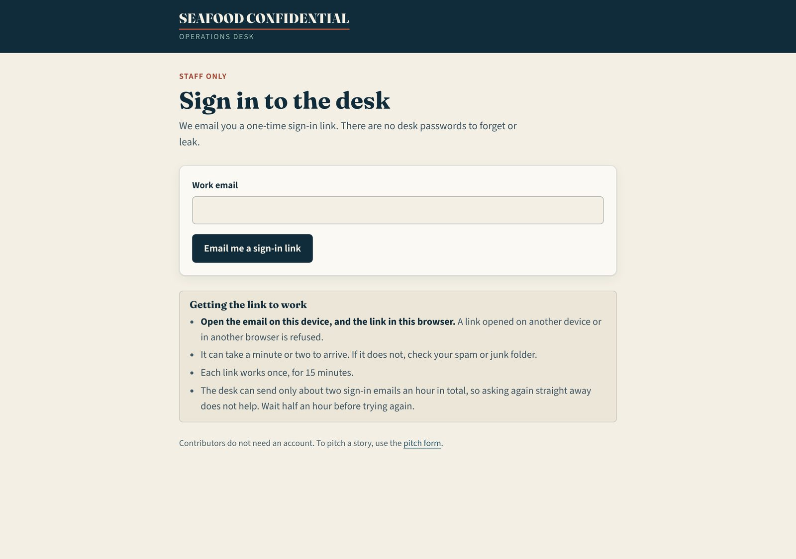
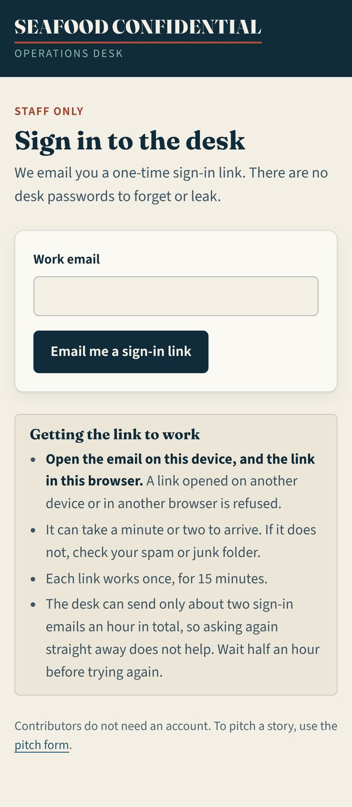

# Sign-in guidance, a custom SMTP plan and owner security

## Summary

Paul invited Dave and asked what else could improve this.

**Dave's status.** He has accepted, as an Owner of the Supabase organization, but has not signed in to the desk yet.

**Two findings:**
- **The sign-in link trap.** The built-in mailer's sign-in link works only in the browser that asked for it, and the free plan does not let us change the template.
- **No two-factor authentication.** Neither owner's Supabase account has it.

**What changed:**
- **The sign-in page now warns up front** (v0.7.4, live): open the email on the same device and browser, check spam, each link lasts 15 minutes, and there is an hourly limit. Before, it said so only after a link had failed.
- **The launch guide has the custom SMTP plan.** That is the change that removes all four mailer limits: membership, volume, browser-bound links and sender.
- **Two-factor authentication is now a founders' security follow-up.**

## What changed

- **Desk (v0.7.4):**
  - A "Getting the link to work" panel under the sign-in form.
  - The "link on its way" message now says "Open it in this browser within 15 minutes".
  - A new setting, `DESK_AUTH_EMAIL` (`builtin` by default, or `custom`). With `custom`, which means custom SMTP and our template whose links work anywhere, the browser and hourly-limit lines disappear.
  - Styled from the desk's tokens. The end-to-end sign-in test checks the panel and the message.
- **Docs:**
  - `docs/LAUNCH_PREVIEW.md`, "Custom SMTP: what it fixes and how": the four limits; the founders' steps with Resend (sending address, DNS records, Supabase SMTP settings); and what the agent session does next: the template, the rate limit, `DESK_AUTH_EMAIL=custom`, and a test sign-in.
  - A security follow-up for two-factor authentication on both owners' Supabase and Google accounts.
  - `docs/DEPLOYMENT.md` and `.env.example` document the new setting.
- **Live:** the desk runs v0.7.4 on revision `sc-desk-00008-gw2`.

## Decisions

- **Warn up front, not after a failure.** Dave's first try is the one that matters. Opening the email on a phone after asking on a laptop is the most likely mistake, and the old page mentioned it only once a link had already failed.
- **Make the warning depend on the mailer, not hard-coded.** When custom SMTP arrives, one setting turns the browser and hourly-limit lines off, so the page never tells people something untrue.
- **Recommend, do not change, the founders' account security.** Two-factor authentication is set by each person on their own Supabase and Google accounts. The Free plan cannot require it for the organization.
- **Custom SMTP needs the founders' choices**: a sending domain and an email-provider account. The guide asks only for those, and the session does the rest.

## Problems and resolutions

- **The Docker daemon had stopped again while the session was paused,** so the first end-to-end run could not reach the local database. It was restarted and the run passed (33/33). This keeps happening whenever the session sleeps; any session that resumes should check Docker before the end-to-end tests.

## Evidence

- **EV-0077** (observation):
  - Dave is an organization Owner, with no desk sign-in yet.
  - Both owners lack two-factor authentication.
  - The built-in template cannot change.
  - Requiring two-factor authentication for the whole organization needs a paid plan.
- **EV-0078:** `pnpm check` (Vitest 132/132), the build and bundle scan, and Playwright 33/33.
- **EV-0079:** desk v0.7.4 is live, and the sign-in page shows the guidance, with 0 axe violations and no overflow on desktop and an iPhone 13.

## Risks and open questions

- **Dave holds full control of the infrastructure** as a Supabase Owner, and so does Paul, both without two-factor authentication. That is the biggest security gap today.
- **Until custom SMTP is in place,** every new staff member needs a Supabase account and organization membership. Two people share about two sign-in emails an hour.

## Next actions

1. **Dave:** sign in at the desk, opening the email on the same device and browser. Settings, under Staff, will show it.
2. **Paul and Dave:** turn on two-factor authentication on your Supabase accounts (and the Google accounts that own the Cloud project), and save the recovery codes.
3. **Founders:** choose a sending domain and create a Resend account, following "Custom SMTP: what it fixes and how" in the launch guide. Then the session does the rest.
4. **After SMTP:** an "Add a staff member" screen, so owners add people without an operator.
