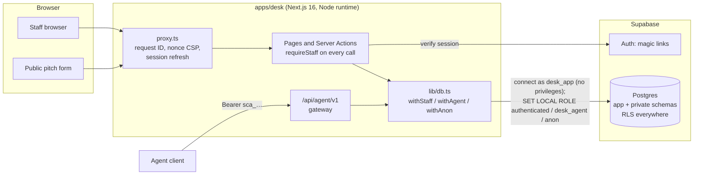

# Operations desk (v0.7.2)

The operations desk for Seafood Confidential:
- staff sign-in;
- the guest pitch queue;
- editorial items with one next action each;
- source and rights records;
- **story text written in the desk**;
- **publishing to the public static site**, with the newsletter on Kit;
- an agent gateway in which agents publish only under the owner's switches and automated checks.

Code lives in [`apps/desk`](../apps/desk); the database lives in [`supabase/`](../supabase). Decisions:
- [ADR-003](../decisions/ADR-003-desk-foundation-stack.md): stack and data access.
- [ADR-005](../decisions/ADR-005-desk-publishing-without-ghost.md): a Ghost-free start, agent publishing under policy. It supersedes ADR-004 and the Ghost part of ADR-001.

Hosting and costs: [planning/HOSTING_AND_COSTS.md](planning/HOSTING_AND_COSTS.md); deployment: [DEPLOYMENT.md](DEPLOYMENT.md).

## Publishing (v0.4.0, ADR-005)

- **Writing.** Every staff member writes the story text on the story page, in Markdown. Every save is kept as a revision. A save from a page opened before someone else's save is refused, and the newer text is kept (AT-08). An agent proposal can be adopted as the starting text; it stays labelled as AI-written.
- **Publishing.** Owners and managing editors publish, update and unpublish from the Publishing panel. The desk rebuilds the whole public site and deploys it: a local folder in development (`pnpm --filter @sc/desk site:serve`), Firebase Hosting in production. Warnings (no sources, uncleared assets, quotes or contact details in agent text) come back first, and one click goes ahead anyway.
- **Newsletter.** Ticking "Also email it" schedules a Kit broadcast a few minutes later, at most once. An uncertain result asks a person to check Kit; the desk never resends.
- **Agents.** With the `drafts.publish` scope, an agent can publish its own proposal, but only when all of the following hold:
  - the owner switched agent publishing on in Settings;
  - the story's section is open;
  - nobody has written or taken over the story;
  - every check in the database passes: citable sources, no quotes, no contact details, no images, no HTML, length, the daily cap, and email only if allowed.

  Refusals list the failed checks. Agent stories carry an "AI agent" label and the owner's disclosure.
- **Stopping agents.** Anyone on staff can press **Stop agent publishing** (Publishing page or Settings). It cancels queued agent jobs immediately.
- **Publishing log.** `/publishing` lists every publication by people and agents, with refused checks, acknowledged warnings and anything that needs attention.

### Publishing safeguards (v0.4.1)

- **What is live is what was published.** Each story records the revision it was published at. Every rebuild of the site uses those revisions, never text saved since, so an editor can keep working on a live story without it going out. Status moves to and from Published only through publishing; no API role can set it by hand (a database trigger).
- **One build at a time, fenced.** A job is claimed with a token and a 5-minute lease. The desk renews the lease during the deploy and confirms it right before the release. A worker that lost its lease cannot read the snapshot, send email or record an outcome.
- **The newsletter goes out at most once per job.** The attempt is recorded in the database before Kit is called, and a second attempt is refused. A live story is updated, not published again. Publishing again with email after an unpublish warns that subscribers were already emailed.
- **Agent jobs are re-checked when they run.** A revoked token, a rejected proposal, withdrawn email permission or the switch turned off cancels the job, and the reason is recorded. A retry publishes the revision the agent's job froze, never a person's later edit.
- **Agents cannot probe the checks.** Content checks run only once the switch, lane and grant checks pass, and an agent gets 10 refused requests a day. Refusals are recorded, and the agent reads them with `jobs.read`.
- **Agent text is checked as readers see it.** The database refuses:
  - HTML and HTML character references;
  - quotations, including block quotes in lists;
  - links other than to cited sources;
  - email addresses and phone numbers, including ones hidden by Markdown escapes, emphasis or invisible characters.

  The desk checks the rendered page once more before deploying.

## Public site: preview mode, standing pages, samples, sweep (v0.5.0–v0.6.0)

- **Preview mode.** With `SITE_PREVIEW_NOTICE` set, every public page shows that text in a banner, carries `noindex`, and `robots.txt` says `Disallow: /`. The desk itself always sends `X-Robots-Tag: noindex, nofollow`.
- **Standing pages.** Each Markdown file in `apps/desk/site-src/pages/` becomes a page at `/<file name>/`, linked from every footer and listed in the sitemap.
  - Front matter needs `title`, `description` and an optional numeric `order` (footer order).
  - `{{pitch_url}}` is replaced with the pitch form's address.
  - Headings start at h2 whatever level the file uses.
  - Names that would collide with site paths (`stories`, `sections`, `assets`, the feed and sitemap) are refused.
  - The pages are copied into the image at build time, so a change needs a redeploy.
- **Sample stories.** A story marked `is_sample` is placeholder content for a preview.
  - Only an operator (the database owner) can set or clear the flag; a trigger refuses every API role.
  - The site labels samples everywhere, and the builder refuses to publish a site that is not a preview while any sample is live.
  - In the desk, samples show a badge, and their next action is "Sample: nothing to do".
  - `supabase/sample/preview-content.sql` loads seven; `remove-preview-content.sql` removes them (steps in [LAUNCH_PREVIEW.md](LAUNCH_PREVIEW.md)).
- **Publishing sweep.** `POST /api/publishing/sweep` runs up to ten waiting publish jobs, for a scheduler such as Cloud Scheduler.
  - It exists only when `PUBLISH_SWEEP_INVOKER` names the calling service account; otherwise it answers 404.
  - It accepts only a Google-signed RS256 ID token from that account, issued for that exact address, with a verified email and at most an hour old.
  - Refusals are logged with a reason class and the request ID, never the token.
  - Without a scheduler, waiting jobs run after each publication (up to three) or from "Run … queued jobs now" on `/publishing` (up to five per press).

## Story images and motion (v0.7.0, ADR-006)

- **A lead image per story.** On the story page, "Lead image" takes a JPEG, PNG, WebP or AVIF of at least 640 px and up to 15 MB. It also takes alternative text, an optional caption, where the subject sits, and the rights record that covers the image. Add the rights record first, under Rights and credits.
- **What the desk does with it:** it makes AVIF and WebP renditions at the site's widths, turns the picture upright, and removes all metadata, location included. The original is kept for the record.
- **How long, and what it cannot read (v0.7.1):**
  - Processing takes 20 to 60 seconds on the live desk's single CPU, and the desk works on one image at a time.
  - The largest rendition is 2400 px wide, or less for portrait and square pictures, at most about 4.3 megapixels, which keeps processing within the server's memory.
  - HEIC photographs (an iPhone camera's usual format) cannot be read: export them as JPEG first. Choosing a photograph on the iPhone itself converts it.
- **What readers see.** The image appears on the site only while its rights record is cleared for the web.
  - Publishing pins the image. Replacing or removing it on a live story changes the site only when the story is updated.
  - Illustrations and generated images are labelled as such.
  - Agents never publish a story that has a lead image.
- **On the site:**
  - The image leads the story page, with its caption and credit.
  - Cards use it as a decorative thumbnail. A story without one shows a drawn plate of its section.
  - Previews on social media use it (`og:image`).
- **Motion.** The public site animates in layers, tuned from the motion tokens in `brand/tokens.json` (see the sc-visual-codex skill).
  - `SITE_MOTION` picks the preset: `calm`, `standard` or `expressive`, or `off` for a still site.
  - Readers can turn animation off in the footer, and `prefers-reduced-motion` turns it off.
  - Without JavaScript every page is complete.

## Scope delivered in this version

| Ticket | Delivered | Not yet |
| --- | --- | --- |
| SC-005 Private operations shell and auth | Magic-link sign-in (sign-up disabled), staff principals and roles, Row Level Security on every table, nonce CSP, request IDs, audit trail, OpenTelemetry and structured logs | Staff invitations from the UI (owner uses the operator CLI) |
| SC-006 Pitch intake, sources and rights | Public `/pitch` form (text only, consent-gated, throttled, receipt only), pitch queue and decisions, source records with an agent-processing flag, rights records with provenance, credit and permitted uses | Contributor accounts, media intake |
| SC-007 Editorial queue and Ghost references | Items with content IDs (`SC-YYYY-NNN`), owner, status, section, format, focus, regions, species, due date; one unique Ghost post per item; next action with the exact Ghost editor link; release gate (Ghost link, sources, cleared rights with credits) | Ghost webhooks (ADR-001 keeps Ghost's own status separate) |
| SC-009 Scoped agent draft gateway (first slice) | Token auth, contract validation, scopes, item grants, SQL-side redaction, idempotent `drafts.propose`, `jobs.read`, per-agent request budget, flood guards, audit of every authenticated request | `drafts.revise` and `social.propose` (need SC-008 and SC-011), an MCP adapter |

## Architecture



- **One authorization boundary: the database.** The server connects as `desk_app`, a `NOINHERIT` login role with no privileges of its own. Each unit of work is a transaction that binds the caller (`request.jwt.claims` for staff, `app.agent_principal_id` after `app.authenticate_agent` for agents), switches role with `SET LOCAL ROLE`, and lets Row Level Security and column grants decide. A query issued outside the helpers runs as `desk_app` and fails.
- **Defense in depth in the app.** Every page, Server Action and route calls `requireStaff()` (or validates the agent token) itself; the proxy is not a security boundary. Inputs are validated with zod against the same bounds as the database constraints. SQL is always a tagged template (ESLint forbids `sql.unsafe`).
- **Schemas.** `app` holds operations records; `private` holds agent credential hashes, the audit trail and intake throttling, reachable only through `SECURITY DEFINER` functions with `search_path = ''`.

## Running it locally

Prerequisites: Node 24 (`.nvmrc`), pnpm 12, Docker. Everything below runs from the repository root.

```bash
pnpm install
```

```bash
pnpm db:start
```

```bash
pnpm desk:env
```

```bash
pnpm --filter @sc/desk staff add --email you@example.test --name "Your Name" --role owner
```

```bash
pnpm desk:dev
```

Open <http://127.0.0.1:3000>, request a sign-in link and open it from Mailpit at <http://127.0.0.1:54324>. `pnpm desk:env` writes two git-ignored files from `supabase status`: `apps/desk/.env.local` for the app (publishable key, `desk_app` URL, intake hash secret, Server Actions key) and `apps/desk/.env.ops.local` for the operator CLI (secret key and database owner URL). See [`apps/desk/.env.example`](../apps/desk/.env.example) for every variable.

## Security model

| Concern | Control | Verified by |
| --- | --- | --- |
| Staff access | Active human principal + active staff assignment, checked by RLS on every query; disabled principals and revoked assignments see nothing on the next request | pgTAP `02_staff_access`; E2E "disabling a staff member…" |
| Reader or contributor identities | A Supabase identity without a principal confers nothing (`/no-access`); Ghost members are a separate system and are never accepted | pgTAP; E2E AT-03 |
| Roles | Owner: principals, agents, tokens. Owner and managing editor: agent grants, source deletion, audit trail. Editors: editorial work. Staff can update only the columns the workflow changes (column-level grants): submissions, agent proposals, content IDs, provenance and source records cannot be rewritten after insert. Who reviewed or decided is stamped by the database, never taken from the request | pgTAP `01`, `02`; E2E |
| Agents | Named principals; tokens `sca_<prefix>_<secret>` stored as SHA-256; scopes per token; items only when granted; no access to pitches or rights; sources only through `app.agent_item_sources`, which redacts in SQL; cannot update items, approve proposals or insert anything that looks reviewed (column-level insert grants); can record only `agent.*` audit events. Revoking an agent is final and revokes every token it holds | pgTAP `03_agent_access`; E2E gateway suite |
| Public intake | `anon` can execute exactly one function, `app.submit_pitch`: consent-gated, bounded fields, receipt only, honeypot, no uploads; 5 per client per hour and 200 per hour overall, serialized with an advisory lock so bursts cannot exceed either limit. The client is a keyed daily hash of the address that the nearest of `DESK_TRUSTED_PROXY_HOPS` proxies appended (required in production; with 0, all clients share one bucket) | pgTAP `04_…`; E2E; units |
| Audit | Append-only `private.audit_events` (update, delete and truncate refused), actor derived from the bound identity, request ID on every row including trigger-written rows. Recorded: every gateway request that carries a well-formed token, intake submissions and throttling, pitch decisions, item status and owner changes, sources, rights, proposals, grants, staff and agent principals, tokens, publish requests, refusals, cancellations, email attempts and outcomes, publishing settings, and refused desk actions. Transport rejections and requests without a token shape are logged, not audited, so anonymous traffic cannot grow the trail | pgTAP `04_…`; E2E |
| Browser | Nonce CSP with `strict-dynamic`, `frame-ancestors 'none'`, `object-src 'none'`, `base-uri 'none'`; HSTS, nosniff, `Referrer-Policy: same-origin`, COOP/CORP, Permissions-Policy; no `x-powered-by` | E2E headers test; unit tests |
| Secrets | No `NEXT_PUBLIC_` variables; the app refuses to start with a Supabase secret key in its environment; the client bundle is scanned for secret shapes and the literal local secret values | `pnpm desk:build` (bundle scan) |
| Server Actions | Next.js origin check (CSRF), 1 MB body limit, stable `NEXT_SERVER_ACTIONS_ENCRYPTION_KEY`; every action re-checks the session and runs under RLS | Code review; E2E |
| Publishing | Jobs are created only by `app.staff_request_publish` (owners and managing editors) and `app.agent_request_publish` (agents with `drafts.publish`, all gates in SQL); the site is built under `desk_publisher`, which can only claim, renew, snapshot, mark the email and complete, each fenced by the claim token; rebuilds use `published_revision`; a trigger stops API roles from setting Published by hand | pgTAP `05_publishing` (121 assertions); E2E publishing suite; units |
| Public site | Static files only, strict CSP (`script-src 'self'`, `form-action` Kit only), Markdown rendered with HTML off and a link allowlist; agent stories carry the AI label and disclosure | Units (`site.test.ts`, `contact.test.ts`); E2E with axe |

**Trust boundary to know about.** The desk server binds identities with `set_config`. Anyone who can run arbitrary SQL on the `desk_app` connection could bind any identity, exactly as with PostgREST's trusted claims. The mitigations are a server-only connection string, parameterized SQL only (lint-enforced) and principal status checks that make revocation effective even for a forged binding.

## Agent gateway v1

`POST /api/agent/v1` with `Content-Type: application/json` (512 KiB limit) and `Authorization: Bearer sca_…`. Requests follow [contracts/agent-tools.schema.json](../contracts/agent-tools.schema.json) (schema version 1.0); `requestId` must also be a safe identifier (letters, digits and `. _ : -`). The order of checks is fixed: transport; pre-database guards (no token shape, no database work; 20 failed authentications per client per minute; at most 4 concurrent gateway transactions per instance, 32 queued); authentication inside the database (revocation is immediate); the per-agent budget (`DESK_AGENT_RATE_PER_MINUTE`, default 120, counted in the database); contract; token scope; then Row Level Security for every object. Every request past the token-shape check is written to the audit trail with its `requestId`.

Successful responses:

```json
{ "schemaVersion": "1.0", "requestId": "req-…", "ok": true, "tool": "items.read", "result": { "…": "…" } }
```

Errors:

```json
{ "schemaVersion": "1.0", "requestId": "req-…", "ok": false, "error": { "code": "contract_violation", "message": "…", "details": [] } }
```

| Tool | Result | Notes |
| --- | --- | --- |
| `briefs.list` | `briefs[]` (`briefId` = content ID, title, summary, section, format, status, `dueOn`), `nextCursor` | Granted, active items only; keyset pagination, `limit` 1–50 |
| `items.read` | `item` (no Ghost ID, only `ghostLinked`), `sources[]` | Sources marked "Agents may use" in full; "redacted" ones as `{ sourceId, sourceType, redacted: true }`; staff-only sources never appear |
| `drafts.propose` | `draftId`, `jobId`, `status`, `replayed` | Requires `idempotencyKey`. Cited `sourceIds` must exist on the brief and be visible. Same key and same arguments return the original (200, `replayed: true`); same key with different arguments is `409 idempotency_conflict`. A proposal never publishes |
| `jobs.read` | `state` (`waiting_for_review`, `accepted`, `rejected`) with a plain-language `message` | Jobs are the agent's own proposals |
| `drafts.revise`, `social.propose` | `501 not_available` | Need review snapshots (SC-008) and durable jobs (SC-011) |

Status codes: 200/201 success, 400 `invalid_json`, `contract_violation` (unknown tools such as `posts.publish` or `members.export` stop here) or `invalid_request_id`, 401 `unauthenticated` (with `WWW-Authenticate`), 403 `insufficient_scope`, 404 `not_found` (also for items that exist but are not granted), 409 `idempotency_conflict` or `brief_closed`, 413, 415, 422 `unknown_source_ids` or `unknown_section`, 429 `rate_limited` (with `Retry-After`), 501, 503 `busy` or `unavailable` (retry with the same idempotency key).

Example (local):

```bash
curl -s http://127.0.0.1:3000/api/agent/v1 -H "Authorization: Bearer $SC_AGENT_TOKEN" -H 'Content-Type: application/json' -d '{"schemaVersion":"1.0","requestId":"req-local-0001","tool":"briefs.list","arguments":{"limit":10}}'
```

## Operator CLI

For local work and first-owner bootstrap only (it uses the database owner URL and refuses non-local hosts unless `--allow-remote` is passed). In production the owner manages agents from **Settings**.

| Command | Purpose |
| --- | --- |
| `pnpm --filter @sc/desk staff add --email … --name … --role owner\|managing_editor\|editor` | Create the auth user (admin API) and the staff principal |
| `pnpm --filter @sc/desk staff identity --email …` | A sign-in identity with no desk access (testing) |
| `pnpm --filter @sc/desk staff disable --email …` / `staff list` | Disable a staff member / list staff |
| `pnpm --filter @sc/desk agent create --name … --scopes briefs.list,items.read,drafts.propose,jobs.read [--grant SC-2026-001]` | Create an agent and print its token once |
| `pnpm --filter @sc/desk agent grant\|revoke\|list` | Manage grants and tokens |

## Tests

| Layer | Command | What it proves |
| --- | --- | --- |
| Database policies | `pnpm db:test` | 229 pgTAP assertions: grants, RLS, column privileges, functions, integrity triggers, workflow, audit, and publishing (gates and their bypasses, claim fencing, leases, at-most-once email, re-checks, retries, refusal budget, addresses). Covers AT-03, AT-04, AT-06, AT-07, AT-12 to AT-14, AT-25 and AT-27 to AT-30 at the database layer. Correct on fresh and used databases |
| Units | `pnpm --filter @sc/desk test` | 101 tests: next actions, CSP, redirects, client addresses, tokens, redaction, hashing, cursors, rate guards, validation, every contract example, the site build, deploy fencing (local and Firebase), Kit, and the rendered-text contact check |
| End to end | `pnpm desk:e2e` | 30 tests: real sign-in through Mailpit, the pitch-to-release journey, access control, hostile input, the gateway over HTTP, agent and staff publishing against the local site server, phone layouts; axe WCAG 2.2 AA on every page visited |
| Bundle | `pnpm desk:build` | No secret shapes or local secret values in anything shipped to browsers |

CI runs all of it in the `desk` job of [`.github/workflows/ci.yml`](../.github/workflows/ci.yml) against a local Supabase stack, and the `container` job builds the production image and smoke-tests it. The [agent lab](../apps/agent-lab/README.md) drives a real Claude agent through the gateway (`pnpm lab`; `pnpm lab --self-test` checks the harness without the model).

## Telemetry and logs

- **Traces:** OpenTelemetry through `@vercel/otel`; set `OTEL_EXPORTER_OTLP_ENDPOINT` (and the usual `OTEL_*` variables) to export. Without them spans exist for correlation only.
- **Logs:** pino JSON to stdout with `request_id`, `trace_id` and `span_id`; emails, tokens, cookies and private contacts are redacted by path and are not logged in the first place. Agent requests log the token prefix, never the token.
- **Audit:** `private.audit_events`, readable by owners and managing editors in Settings and summarized on Today ("What failed?").
- **Health:** `GET /api/health` returns status and version only.

## Known limits and next steps

- Staff invitations and role changes from the UI; account recovery is the magic link itself.
- An MCP adapter for agents must reuse this gateway and its policies (SC-009 continuation).
- The flood guards are per instance; with several instances, put a shared limiter (or the platform's) in front.
- Audit retention: the trail is append-only and unbounded; a retention and archive procedure belongs with exports and backups (SC-014).
- **Founder decision, 18 November 2026: the intake limits stay as built** (5 pitches per client per hour, 200 an hour overall, no challenge). Revisit if spam appears; a privacy-respecting challenge can be added later.
- Review snapshots and stale detection (SC-008) before any social or newsletter work.
- Hosted Supabase verification of the role-membership grants and transaction pooling (ADR-003 review triggers, SC-015).
- Firebase Hosting deploys have run live on the preview, through the desk's own deploy code run by an operator (EV-0047, EV-0053). A publication by the desk service on Cloud Run has not run yet. Kit broadcasts are verified only against protocol fakes. Their first live runs are part of SC-015.
- Not built yet: publication at a scheduled time, a public corrections note, and images in stories.
- The legacy "link a Ghost post" form and `ghost_post_id` column remain in the code and schema but are unused (ADR-005).
