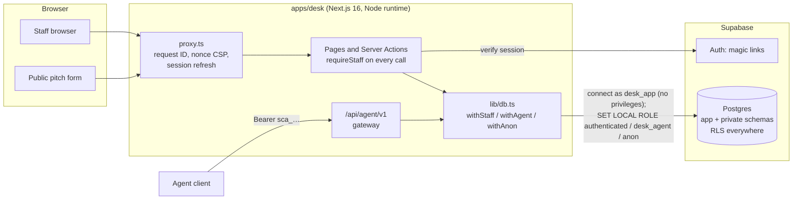

# Operations desk (v0.2.0)

The private operations desk for Seafood Confidential: staff sign-in, the guest pitch queue, editorial items with one next action each, source and rights records, links to the native Ghost editor, and a draft-only agent gateway. Code lives in [`apps/desk`](../apps/desk); the database lives in [`supabase/`](../supabase). Decisions: [ADR-001](../decisions/ADR-001-managed-publishing.md) (Ghost publishes, the desk operates) and [ADR-003](../decisions/ADR-003-desk-foundation-stack.md) (stack and data access).

**What it is not.** The desk never publishes, sends, schedules or changes anything in Ghost. People publish in Ghost; the desk stores the Ghost post ID and links to its editor. Newsletter and social distribution are later tickets (SC-004, SC-008, SC-010) and the Distribution page says so.

## Scope delivered in this version

| Ticket | Delivered | Not yet |
| --- | --- | --- |
| SC-005 Private operations shell and auth | Magic-link sign-in (sign-up disabled), staff principals and roles, Row Level Security on every table, nonce CSP, request IDs, audit trail, OpenTelemetry and structured logs | Staff invitations from the UI (owner uses the operator CLI) |
| SC-006 Pitch intake, sources and rights | Public `/pitch` form (text only, consent-gated, throttled, receipt only), pitch queue and decisions, source records with an agent-processing flag, rights records with provenance, credit and permitted uses | Contributor accounts, media intake |
| SC-007 Editorial queue and Ghost references | Items with content IDs (`SC-YYYY-NNN`), owner, status, section, format, focus, regions, species, due date; one unique Ghost post per item; next action with the exact Ghost editor link; release gate (Ghost link, sources, cleared rights with credits) | Ghost webhooks (ADR-001 keeps Ghost's own status separate) |
| SC-009 Scoped agent draft gateway (first slice) | Token auth, contract validation, scopes, item grants, SQL-side redaction, idempotent `drafts.propose`, `jobs.read`, per-agent request budget, flood guards, audit of every authenticated request | `drafts.revise` and `social.propose` (need SC-008 and SC-011), an MCP adapter |

## Architecture



- **One authorization boundary: the database.** The server connects as `desk_app`, a `NOINHERIT` login role with no privileges of its own. Each unit of work is a transaction that binds the caller (`request.jwt.claims` for staff, `app.agent_principal_id` after `app.authenticate_agent` for agents), switches role with `SET LOCAL ROLE`, and lets Row Level Security and column grants decide. A query issued outside the helpers runs as `desk_app` and fails.
- **Defense in depth in the app.** Every page, Server Action and route calls `requireStaff()` (or validates the agent token) itself; the proxy is not a security boundary. Inputs are validated with zod against the same bounds as the database constraints. SQL is always a tagged template (ESLint forbids `sql.unsafe`).
- **Schemas.** `app` holds operations records; `private` holds agent credential hashes, the audit trail and intake throttling, reachable only through `SECURITY DEFINER` functions with `search_path = ''`.

## Running it locally

Prerequisites: Node 24 (`.nvmrc`), pnpm 12, Docker. Everything below runs from the repository root.

```bash
pnpm install
```

```bash
pnpm db:start
```

```bash
pnpm desk:env
```

```bash
pnpm --filter @sc/desk staff add --email you@example.test --name "Your Name" --role owner
```

```bash
pnpm desk:dev
```

Open <http://127.0.0.1:3000>, request a sign-in link and open it from Mailpit at <http://127.0.0.1:54324>. `pnpm desk:env` writes two git-ignored files from `supabase status`: `apps/desk/.env.local` for the app (publishable key, `desk_app` URL, intake hash secret, Server Actions key) and `apps/desk/.env.ops.local` for the operator CLI (secret key and database owner URL). See [`apps/desk/.env.example`](../apps/desk/.env.example) for every variable.

## Security model

| Concern | Control | Verified by |
| --- | --- | --- |
| Staff access | Active human principal + active staff assignment, checked by RLS on every query; disabled principals and revoked assignments see nothing on the next request | pgTAP `02_staff_access`; E2E "disabling a staff member…" |
| Reader or contributor identities | A Supabase identity without a principal confers nothing (`/no-access`); Ghost members are a separate system and are never accepted | pgTAP; E2E AT-03 |
| Roles | Owner: principals, agents, tokens. Owner and managing editor: agent grants, source deletion, audit trail. Editors: editorial work. Staff can update only the columns the workflow changes (column-level grants): submissions, agent proposals, content IDs, provenance and source records cannot be rewritten after insert. Who reviewed or decided is stamped by the database, never taken from the request | pgTAP `01`, `02`; E2E |
| Agents | Named principals; tokens `sca_<prefix>_<secret>` stored as SHA-256; scopes per token; items only when granted; no access to pitches or rights; sources only through `app.agent_item_sources`, which redacts in SQL; cannot update items, approve proposals or insert anything that looks reviewed (column-level insert grants); can record only `agent.*` audit events. Revoking an agent is final and revokes every token it holds | pgTAP `03_agent_access`; E2E gateway suite |
| Public intake | `anon` can execute exactly one function, `app.submit_pitch`: consent-gated, bounded fields, receipt only, honeypot, no uploads; 5 per client per hour and 200 per hour overall, serialized with an advisory lock so bursts cannot exceed either limit. The client is a keyed daily hash of the address that the nearest of `DESK_TRUSTED_PROXY_HOPS` proxies appended (required in production; with 0, all clients share one bucket) | pgTAP `04_…`; E2E; units |
| Audit | Append-only `private.audit_events` (update, delete and truncate refused), actor derived from the bound identity, request ID on every row including trigger-written rows. Recorded: every gateway request that carries a well-formed token, intake submissions and throttling, pitch decisions, item status, owner and Ghost-link changes, sources, rights, proposals, grants, staff and agent principals, tokens, and refused desk actions. Transport rejections and requests without a token shape are logged, not audited, so anonymous traffic cannot grow the trail | pgTAP `04_…`; E2E |
| Browser | Nonce CSP with `strict-dynamic`, `frame-ancestors 'none'`, `object-src 'none'`, `base-uri 'none'`; HSTS, nosniff, `Referrer-Policy: same-origin`, COOP/CORP, Permissions-Policy; no `x-powered-by` | E2E headers test; unit tests |
| Secrets | No `NEXT_PUBLIC_` variables; the app refuses to start with a Supabase secret key in its environment; the client bundle is scanned for secret shapes and the literal local secret values | `pnpm desk:build` (bundle scan) |
| Server Actions | Next.js origin check (CSRF), 1 MB body limit, stable `NEXT_SERVER_ACTIONS_ENCRYPTION_KEY`; every action re-checks the session and runs under RLS | Code review; E2E |

**Trust boundary to know about.** The desk server binds identities with `set_config`. Anyone who can run arbitrary SQL on the `desk_app` connection could bind any identity, exactly as with PostgREST's trusted claims. The mitigations are a server-only connection string, parameterized SQL only (lint-enforced) and principal status checks that make revocation effective even for a forged binding.

## Agent gateway v1

`POST /api/agent/v1` with `Content-Type: application/json` (512 KiB limit) and `Authorization: Bearer sca_…`. Requests follow [contracts/agent-tools.schema.json](../contracts/agent-tools.schema.json) (schema version 1.0); `requestId` must also be a safe identifier (letters, digits and `. _ : -`). The order of checks is fixed: transport; pre-database guards (no token shape, no database work; 20 failed authentications per client per minute; at most 4 concurrent gateway transactions per instance, 32 queued); authentication inside the database (revocation is immediate); the per-agent budget (`DESK_AGENT_RATE_PER_MINUTE`, default 120, counted in the database); contract; token scope; then Row Level Security for every object. Every request past the token-shape check is written to the audit trail with its `requestId`.

Successful responses:

```json
{ "schemaVersion": "1.0", "requestId": "req-…", "ok": true, "tool": "items.read", "result": { "…": "…" } }
```

Errors:

```json
{ "schemaVersion": "1.0", "requestId": "req-…", "ok": false, "error": { "code": "contract_violation", "message": "…", "details": [] } }
```

| Tool | Result | Notes |
| --- | --- | --- |
| `briefs.list` | `briefs[]` (`briefId` = content ID, title, summary, section, format, status, `dueOn`), `nextCursor` | Granted, active items only; keyset pagination, `limit` 1–50 |
| `items.read` | `item` (no Ghost ID, only `ghostLinked`), `sources[]` | Sources marked "Agents may use" in full; "redacted" ones as `{ sourceId, sourceType, redacted: true }`; staff-only sources never appear |
| `drafts.propose` | `draftId`, `jobId`, `status`, `replayed` | Requires `idempotencyKey`. Cited `sourceIds` must exist on the brief and be visible. Same key and same arguments return the original (200, `replayed: true`); same key with different arguments is `409 idempotency_conflict`. A proposal never publishes |
| `jobs.read` | `state` (`waiting_for_review`, `accepted`, `rejected`) with a plain-language `message` | Jobs are the agent's own proposals |
| `drafts.revise`, `social.propose` | `501 not_available` | Need review snapshots (SC-008) and durable jobs (SC-011) |

Status codes: 200/201 success, 400 `invalid_json`, `contract_violation` (unknown tools such as `posts.publish` or `members.export` stop here) or `invalid_request_id`, 401 `unauthenticated` (with `WWW-Authenticate`), 403 `insufficient_scope`, 404 `not_found` (also for items that exist but are not granted), 409 `idempotency_conflict` or `brief_closed`, 413, 415, 422 `unknown_source_ids` or `unknown_section`, 429 `rate_limited` (with `Retry-After`), 501, 503 `busy` or `unavailable` (retry with the same idempotency key).

Example (local):

```bash
curl -s http://127.0.0.1:3000/api/agent/v1 -H "Authorization: Bearer $SC_AGENT_TOKEN" -H 'Content-Type: application/json' -d '{"schemaVersion":"1.0","requestId":"req-local-0001","tool":"briefs.list","arguments":{"limit":10}}'
```

## Operator CLI

For local work and first-owner bootstrap only (it uses the database owner URL and refuses non-local hosts unless `--allow-remote` is passed). In production the owner manages agents from **Settings**.

| Command | Purpose |
| --- | --- |
| `pnpm --filter @sc/desk staff add --email … --name … --role owner\|managing_editor\|editor` | Create the auth user (admin API) and the staff principal |
| `pnpm --filter @sc/desk staff identity --email …` | A sign-in identity with no desk access (testing) |
| `pnpm --filter @sc/desk staff disable --email …` / `staff list` | Disable a staff member / list staff |
| `pnpm --filter @sc/desk agent create --name … --scopes briefs.list,items.read,drafts.propose,jobs.read [--grant SC-2026-001]` | Create an agent and print its token once |
| `pnpm --filter @sc/desk agent grant\|revoke\|list` | Manage grants and tokens |

## Tests

| Layer | Command | What it proves |
| --- | --- | --- |
| Database policies | `pnpm db:test` | 108 pgTAP assertions: grants, RLS, column privileges, functions, integrity triggers, workflow, audit (AT-25, AT-03, AT-04, AT-06, AT-07, AT-12, AT-13 at the database layer). Mutation-tested: each of 11 deliberate breaks fails a named assertion. Correct on fresh and used databases |
| Units | `pnpm --filter @sc/desk test` | 67 tests: next actions, CSP, redirects, client addresses, tokens, redaction, hashing, cursors, rate guards, validation, every contract example |
| End to end | `pnpm desk:e2e` | 24 tests: real sign-in through Mailpit, the pitch-to-release journey, access control, hostile input, the gateway over HTTP, phone layouts; axe WCAG 2.2 AA on every page visited |
| Bundle | `pnpm desk:build` | No secret shapes or local secret values in anything shipped to browsers |

CI runs all of it in the `desk` job of [`.github/workflows/ci.yml`](../.github/workflows/ci.yml) against a local Supabase stack.

## Telemetry and logs

- **Traces:** OpenTelemetry through `@vercel/otel`; set `OTEL_EXPORTER_OTLP_ENDPOINT` (and the usual `OTEL_*` variables) to export. Without them spans exist for correlation only.
- **Logs:** pino JSON to stdout with `request_id`, `trace_id` and `span_id`; emails, tokens, cookies and private contacts are redacted by path and are not logged in the first place. Agent requests log the token prefix, never the token.
- **Audit:** `private.audit_events`, readable by owners and managing editors in Settings and summarized on Today ("What failed?").
- **Health:** `GET /api/health` returns status and version only.

## Known limits and next steps

- Staff invitations and role changes from the UI; account recovery is the magic link itself.
- An MCP adapter for agents must reuse this gateway and its policies (SC-009 continuation).
- The flood guards are per instance; with several instances, put a shared limiter (or the platform's) in front.
- Audit retention: the trail is append-only and unbounded; a retention and archive procedure belongs with exports and backups (SC-014).
- The global intake ceiling (200 an hour) protects storage but lets a determined sender pause intake for an hour. A privacy-respecting challenge (for example Cloudflare Turnstile) is a founder decision before launch.
- Review snapshots and stale detection (SC-008) before any social or newsletter work.
- Hosted Supabase verification of the role-membership grants and transaction pooling (ADR-003 review triggers, SC-015).
