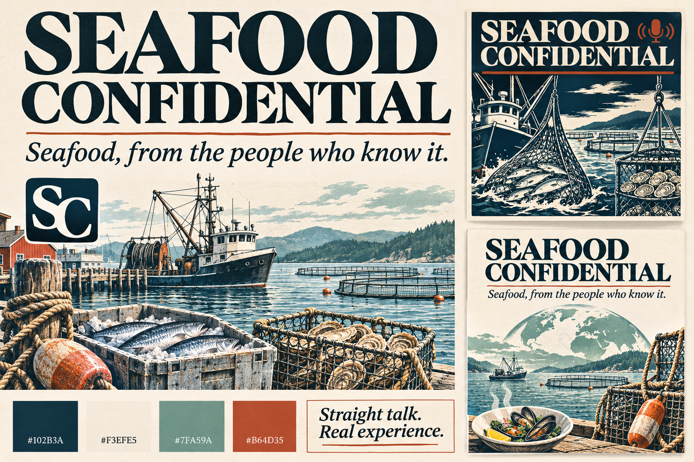

# Seafood Confidential

## Launch and Development Packet

Prepared for Paul Phillips and the founding team

November 17 2026

Brand direction, editorial operations, product architecture and a four week development sprint

Seafood Confidential will bring experienced people in fisheries, aquaculture and the seafood trade into a publication that is useful to professionals and readable by anyone who wants to understand the food. This packet defines a practical first release and the operating system behind it.

The proposed launch combines a public publication, a weekly newsletter, invited contributor access and a small private operations desk. AI agents help prepare and organize work. The managing editor controls what reaches readers.

**Recommended first release:** one substantive article each week, one weekly dispatch, LinkedIn and Facebook distribution, and a prepared path to a monthly interview podcast.

**Planning basis:** two founders, one experienced full stack developer, a theme based public site, English language launch with worldwide coverage, and a modest initial audience. The sprint estimate is 118 to 160 engineering hours, including reserve. Decisions and estimates remain proposed until the founders adopt them.

<!-- PAGEBREAK -->

# The founder decision brief

## Build a publication the friend can operate

The central product is a dependable editorial routine. Your friend should be able to open one private desk, see the pieces awaiting a decision, commission a guest, review sources, open the article in its editor and prepare the week's distribution. The public site should remain available even when an automation is paused.

Use **Ghost Publisher** for the website, article editor, contributors, member access and newsletter. Add a small **Next.js and TypeScript operations desk**, backed by **Supabase Postgres and Auth**, for pitches, source records, review snapshots, agent permissions and job status. Use **Buffer Team** for the two initial social channels. Add a dedicated podcast host when the audio pilot is ready. These are proposed choices, with the current vendor capabilities documented in the references. [S1-S8]

## Decisions this packet recommends

| Decision | Recommended starting point |
|---|---|
| Audience | Seafood professionals first, with clear explanations for interested food readers |
| Editorial identity | A practitioner owned publication about how seafood actually works |
| Core cadence | One feature and one short dispatch each week |
| Contributions | Public pitches and invited writers; editorial review before publication |
| AI authority | Research, organization and draft preparation; human release in the native publishing tools |
| Podcast | Two private pilots, then a monthly episode if the workload is sustainable |
| Software allowance | $119-$169 per month at the stated launch assumptions, before labor and overages |

## Read and use the packet

The brand and reader experience come first. The middle sections specify the portals, content records, agent boundaries and sprint. The final sections cover editorial operations, podcast production, costs and decisions. The separate workbook tracks the work. The development kit contains the specifications, issue backlog, contracts, examples and reusable editorial templates.

At kickoff, name the managing editor, approve the first audience and weekly capacity, choose the account owner and set the budget. A domain and social handles should be checked and reserved through founder controlled accounts before the public launch.

<!-- PAGEBREAK -->

# Positioning and audience

## Seafood from the people who know it

**Seafood Confidential**

**Seafood, from the people who know it.**

Suggested descriptor: Fisheries, aquaculture, trade, and the people behind the food.

Your shared decades in the industry give this project a useful starting advantage: experience of decisions that ordinary coverage often encounters only after the outcome. Paul can draw on his work across seafood marketing, markets and logistics. The publication should make room for the friend's own experience in their approved biography, without assuming details that have not been supplied.

The first audience is buyers, fishers, farmers, processors, suppliers, chefs and other people whose work touches seafood. Curious consumers are welcome. Explain a trade term at the moment it matters, and anchor each feature in a question a reader can recognize.

## The editorial promise

Every substantive piece should help a reader understand a real seafood decision, the people affected and the evidence behind it. A story might explain why a shipment's value changes between landing and sale, how a farmer manages a difficult production choice, or what a new rule means in a specific fishery.

Candor is a tone. Reporting still needs dates, attribution, context and a way to correct mistakes. The word Confidential can suggest access and honest conversation; it should not imply that an ordinary contact form provides protected anonymity.

## A distinct reason to return

SeafoodSource already offers expert podcast discussions, while the Responsible Seafood Advocate publishes industry journalism and expert perspectives. This supports choosing a clear founder led point of view: practical decisions, personal experience and thoughtful exchanges between different parts of the trade. It does not establish an unoccupied market. [S16-S17]

A preliminary indexed web scan did not identify an obvious exact title publication called Seafood Confidential. Domain registration, handles, business registries and trademarks are still unverified. The adjacent food media title Culinary Confidential reinforces the value of a clear fisheries and aquaculture descriptor. [S18]

<!-- PAGEBREAK -->

# The initial visual identity

## Working Waterfront

The recommended direction combines an editorial masthead, warm paper, dark ink and working maritime imagery. The concept above is an AI generated visual exploration for article, podcast and social formats, not final artwork or documentary photography.

| Color | Hex | Intended use |
|---|---|---|
| Ink navy | #102B3A | Masthead, body text, primary controls |
| Salt paper | #F3EFE5 | Page backgrounds and quiet reading space |
| Sea glass | #7FA59A | Secondary surfaces and illustration |
| Rust | #B64D35 | Small accents and selected emphasis |

Use serif headlines and a clear sans serif interface. Prepare a wordmark, SC avatar and reusable layouts, checking text contrast. The live image library should represent fisheries, farms and food across regions through credited, permissioned photography. Keep aquaculture and freshwater production visible.

<!-- PAGEBREAK -->

# The editorial structure

Use six sections at launch. Geography, species and format belong in tags and story metadata, which keeps the main navigation understandable.

| Section | Editorial purpose |
|---|---|
| On the Water | Fisheries, harvest communities, gear, livelihoods and working conditions |
| At the Farm | Aquaculture production, husbandry, feed, hatcheries and production choices |
| The Trade | Buying, selling, processing, cold chain, market formation and logistics |
| Rules and Reality | Dated explainers about a defined rule, jurisdiction and practical consequence |
| At the Table | Species knowledge, handling, food culture, chefs, value and consumption |
| Voices | Guest essays, interviews, oral histories and moderated exchanges |

## Give every story a visible form

Use a format label such as reported feature, explainer, interview, first person account, opinion or sponsored contribution. Readers should be able to distinguish an experienced person's recollection from a documented finding, and an argument from an impartial account of events.

Each article has a byline, relevant affiliation, publication date, update date where needed, image credits and source notes. An industry relationship that matters to the story should appear with the story. A guest's biography is separate from the editor's assessment of their claims.

## Start with questions that fit your access

Strong early commissions include what the price of a fish actually contains, how a species earns a market, what happens to a tuna shipment between landing and buyer, and the production decisions behind a particular oyster or shrimp farm. These are proposed reporting assignments, not completed findings.

A six week commissioning plan appears later in the packet. Aim to have three publishable pieces and one reserve idea before launch. The weekly email can point to the main article, add three useful source links and ask one specific question. An interview can supply that week's feature instead of adding a second production obligation.

<!-- PAGEBREAK -->

# The reader experience

## Make the next useful action obvious

The homepage introduces the publication, features one strong current story and offers a clear newsletter signup. Below that, show recent articles, the six sections and a small invitation to contribute. Keep the founders visible through their own introductions and relevant bylines.

The article page needs comfortable reading on a phone, a concise summary when useful, relevant source links, photo credit, author context, related stories and a way to submit a correction. A Rules and Reality article should display its jurisdiction and the date on which its status was checked.

## The launch page inventory

| Page or action | First release behavior |
|---|---|
| Home and section archives | Latest content, featured story, clear navigation and tags |
| Article and author pages | Accessible reading, byline, sources, disclosures and related pieces |
| About and editorial principles | Founder biographies, coverage promise and corrections contact |
| Newsletter signup and account | Native Ghost member controls, confirmation and unsubscribe |
| Pitch and guest interest | Short form feeding a private editorial queue |
| Contact and policies | Practical contact routes, privacy information and contribution terms |
| Podcast landing page | Publish only when a trailer or episode is ready; episode pages reuse the article system |

## Participation without a moderation backlog

Let readers send a question, propose an article or express interest in being interviewed. A submission becomes a private pitch. The editor decides whether to commission it and invite the writer. A reader account never automatically grants authoring authority.

Start with replies and a pitch queue. Add member comments when the friend has a clear moderation routine. The initial site needs no public member directory, direct messaging, open uploads or social network style feed. Those can be evaluated after readership and moderation capacity are understood.

Native tags and search are enough for the first release. Advanced combinations of species, region, production method and rule status are a later feature when there is enough content to make them useful.

<!-- PAGEBREAK -->

# Portals and responsibilities

Five surfaces cover the work. They can share links and branding while using the existing tools suited to each task.

| Surface | Who uses it | What they can do |
|---|---|---|
| Public publication | Readers and prospective contributors | Read, subscribe, browse and submit a pitch |
| Native member portal | Newsletter members | Manage their own membership and subscription preferences |
| Native Ghost editor | Founders and invited writers | Draft and edit within their assigned role |
| Private operations desk | Owner and managing editor | Triage pitches, assign work, review sources and track distribution |
| Agent gateway | Approved AI service identities | Perform narrowly permitted draft and reporting actions |

## The friend's private desk

The default screen should answer: What needs my decision today? Show drafts awaiting review, missing source or rights information, this week's planned story, social drafts needing attention, connector failures and recent reader questions. Each item should open the actual next action, such as Review sources or Open in Ghost.

Use five navigation items: Today, Stories, Contributors, Distribution and Settings. Keep implementation details behind an administrator view. A status such as Needs a source is more useful to the editor than a queue identifier.

## Role choices that matter

Paul is the proposed publication owner; the friend is the proposed managing editor. The founders should confirm the legal and billing owner separately. Give trusted backup access to a second human and test account recovery.

Invite guest writers as Ghost Contributors. That role can edit its own drafts and cannot publish. Ghost Authors can publish their own posts, while Editors can publish other writers' posts. Only grant the broader role deliberately. Ghost's current Publisher plan includes three counted staff users; Contributors do not count toward that limit. [S1-S2]

The operations desk is staff only in the first sprint. Guests use the native writer experience, an approved brief and a human managed communications thread. Ghost treats invited staff as trusted content creators, including rich HTML and embeds. Invite trusted guests and review their content; unknown public users stay in the moderated pitch queue. [S25]

<!-- PAGEBREAK -->

# A useful smart publishing workflow

## Turn one conversation into a reviewed package

Imagine Paul records a fifteen minute voice note about a difficult delivery or interviews a producer. The editor creates a story and attaches the permitted recording. An existing approved assistant prepares a transcript and marks uncertain names and claims. The writer develops the article and source notes. This workflow uses the team's chosen assistant; an in-house transcription or model service is outside the sprint estimate.

When the editor reviews a version, the system records which article revision and media assets were checked. An assistant then proposes a title, summary, newsletter introduction and separate LinkedIn and Facebook copy. The editor can compare each proposed derivative with the story that supports it.

| Step | Human decision | Useful automation |
|---|---|---|
| Pitch | Is this a worthwhile question? | Organize the idea and suggest missing context |
| Commission | Who owns it and when is it due? | Prepare the brief and checklist |
| Develop | Which claims and quotations are justified? | Transcript, source records and draft assistance |
| Review | Is this version ready for readers? | Highlight unresolved claims, rights and changes |
| Release | Publish the article, send the email, approve social posts | Open the correct native tool and record outcomes |
| Learn | What should we follow up? | Summarize useful replies and aggregate results |

## Keep control simple in the first release

The first sprint gives agents draft authority. The human editor publishes or schedules in Ghost and approves or schedules in Buffer. A review record in the operations desk supports the workflow; it does not remove the native editor's publishing permission.

If an article changes after review, its derivatives become stale in the desk and require another check. The friend receives a specific instruction to inspect or cancel any queued version affected by the change. This is a visible operational control in the first release, not a promise that a custom gate can stop every action inside a separate vendor system.

Automatic release can follow later, with stronger enforcement, version checks and reconciliation. The useful initial achievement is a complete, traceable publication loop that a human can run comfortably.

<!-- PAGEBREAK -->

# Sources rights and editorial trust

## Keep the information that changes meaning

A source record should include its publisher, title, URL, publication date, retrieval date, language, the claim it supports and a page or recording timecode where applicable. Store the statistical period and units separately. Common and scientific species names help where local names could create ambiguity.

For a regulatory story, also record the jurisdiction, issuing authority, instrument identifier, current stage, effective date and any comment deadline. A proposal, an adopted measure and a rule already in force need different labels. Confirm the operative source before turning an announcement into practical advice.

NOAA's rules pages and FAO GLOBEFISH are useful starting points for discovery. Expand the source registry through relevant national authorities, EUR-Lex, regional fisheries bodies and researchers as coverage develops. The registry should support editorial judgment, with the source language preserved and consequential translations checked. [S19-S20]

## Rights belong to each asset

Record permission for an article, image, recording, edited clip and translation separately. Keep the source file, credit, license scope and consent evidence together. An interview release does not automatically authorize synthetic voice use. Do not put sensitive source contacts into the public CMS or general agent context.

Contribution terms should state attribution, editing, permitted uses, any compensation, prior publication, withdrawal timing and the corrections process. The founders need a jurisdiction appropriate agreement before commissioning work. The kit provides an intake and terms checklist rather than inventing a signed agreement.

## Correct the whole publication package

Give readers a visible corrections contact. When a material fact changes, record the reason, retain the earlier version internally, publish a dated note and inspect linked email, social and audio derivatives. A website edit cannot recall an already delivered email.

Separate editorial approval from sponsorship approval. Relevant commercial relationships should be disclosed where the audience encounters the content. For endorsements, the FTC's guidance emphasizes clear disclosure of material connections; other jurisdictions may also apply. [S15] The brand should be candid about the founders' industry relationships and precise about the reporting that supports each piece.

<!-- PAGEBREAK -->

# The recommended backend

## Use managed publishing and build the missing workflow

Ghost remains the authoritative home for article bodies, published URLs, authors, members and newsletters. The operations database holds pitches, assignments, sources, permissions, review snapshots and distribution records linked to Ghost identifiers. This avoids maintaining two competing article editors.

| Component | Responsibility | First release |
|---|---|---|
| Ghost Publisher | Publication, editor, writers, members and email | Theme configuration and small brand customizations |
| Next.js and TypeScript | Private operations desk and server routes | One app with a small staff interface |
| Supabase Postgres and Auth | Operations records and staff identity | Row permissions, private files and exportable data |
| Buffer Team | Social drafts and human scheduling | LinkedIn and Facebook only |
| Vercel Pro | Commercial hosting for the private app | One deploying developer and separate preview configuration |
| Podcast host | Audio and RSS distribution | Add after the pilot decision |

Ghost exposes both content and administration APIs. The administration API is powerful, so its credentials belong on the server behind the narrow application gateway. The browser and general agents must not receive them. Draft writes must preserve Ghost's concurrency checks. [S3-S4]

## Why this route

The first sprint should spend its engineering time on editorial work that a general publication tool does not already solve. Payload provides granular access controls and supports a custom deployment; choosing that route also creates database, storage and email integration responsibilities. [S27-S28] A fully custom publishing workflow becomes worthwhile when its control is central to the product. If the friend already has a dependable publishing setup, evaluate its migration cost before replacing it.

Reconsider the default if a mandatory approval chain must govern every human publishing action, or if custom contributor workspaces and complex content permissions become central. Those are concrete reasons for a custom CMS. At launch, native publishing and a bounded operations desk offer a smaller maintenance commitment.

<!-- PAGEBREAK -->

# Content records and ownership

The database should preserve enough context to explain why a story is ready and how each derivative was produced. It should not copy every vendor record or store subscriber data merely because an API makes it available.

| Record | Essential content | Authority |
|---|---|---|
| Story | Ghost post ID, assignment, section, format, region and species | Ghost body; operations metadata |
| Source and claim | Source URL, dates, supported claim, passage or timecode, review state | Operations database |
| Contributor | Ghost user ID, contact, biography, affiliation and terms status | Staff controlled records |
| Asset and permission | File reference, credit, permitted uses, expiry or restrictions | Private asset store and consent record |
| Review snapshot | Article version, content hash, reviewer, timestamp, scope and findings | Immutable application record |
| Derivative | Article revision, destination, exact proposed text and asset references | Operations record linked to provider draft |
| Distribution job | Destination, provider ID, attempts, state and last observation | Local intent plus observed provider state |
| Agent grant | Allowed tools, assigned stories, expiry and usage limit | Server enforced authorization |

## Use fields where they are reliable

Rich article metadata lives in Postgres. Do not assume Ghost's advertised custom fields are general post fields; the documented feature concerns members. [S24] For the first release, publish selected, reviewed metadata through tags and a visible article source note. Keep confidential source detail private.

A story can be Draft, In review, Changes requested, Ready for human release or Published. Readiness applies to a specific version. If a number, quote, image, source status or relevant disclosure changes, review that affected output again.

Store an IANA timezone with scheduled intent and persist timestamps in UTC. Show the editor their chosen local time. A distributed team should not have to infer whether Friday at nine means Philadelphia, London or the source's location.

Keep account mappings explicit. A Ghost member is a reader. A Ghost contributor is a writer. A staff user in the operations desk is a separate authorized identity. Matching email addresses do not grant new roles.

<!-- PAGEBREAK -->

# How AI agents should work

## Give agents small jobs with useful evidence

The first release should support the friend's existing agents through documented tools. It does not require a new autonomous agent platform. An HTTP contract can serve approved clients; an MCP adapter can expose the same bounded actions when the chosen client needs it.

| Agent role | Useful work | Information it receives |
|---|---|---|
| Research | Suggest briefs and attach source records | Approved public sources and assigned questions |
| Interview | Prepare transcripts and timecoded excerpts | Recordings explicitly permitted for processing |
| Production | Propose headlines, summaries and channel variants | Assigned draft or reviewed article revision |
| Distribution | Create social drafts and read their status | Exact approved draft payload and allowed channels |
| Audience | Summarize aggregate results and reader themes | Aggregates and editor selected messages |

The v1 contract contains briefs.list, items.read, drafts.propose, drafts.revise, social.propose and jobs.read. Humans attach sources and record reviews. Brief creation and aggregate metrics tools are later additions. Transcription and analysis use existing approved assistants. The developer maps these internal tools to current vendor APIs.

## Enforce the limits in code

Each agent has a separate revocable credential, allowed actions, assigned resources and expiry. Validate every request against a schema and check authorization before accessing a row or calling a provider. Deny publication, newsletter sending, member export, role changes, spending and outbound invitations in the first sprint.

Buffer's current Needs Approval role preserves the draft approval requirement across API and MCP usage. Use a dedicated restricted identity, not an owner key. Test that an agent's attempted release never publishes and remains a draft; the provider may save a draft instead of returning an error. [S6]

Source pages, documents and transcripts cannot change agent permissions. Embedded instructions to reveal credentials or publish have no authority. Mask private contacts from logs, approve model data handling, meter calls and let the editor pause an agent without taking the publication offline.

<!-- PAGEBREAK -->

# Reliability and recovery

## Record intent before calling another service

Use a durable Postgres job record for each external draft operation. It records the story revision, destination, exact payload, request key, provider identifier, attempts and last observed outcome. A repeated request with the same key returns the existing job. The same key with different content is a conflict.

If the provider may have accepted a request before a timeout, mark the job Needs reconciliation. Check the provider or ask the editor to reconcile it before trying another creation. A local unique key alone cannot guarantee exactly one external post when a provider lacks suitable idempotency support.

For incoming webhooks, deduplicate notifications and treat them as cues to verify upstream state. Do not assume a vendor supports signed webhooks until its deployed interface has been checked. A bounded periodic comparison should recover a missed update. Ghost provides content event webhooks; the precise trust and retry behavior belongs in the integration implementation. [S23]

## Keep private work private

Enforce staff and resource permissions on every server route and relevant database table. Supabase administrative secrets can bypass row policies; keep them out of the browser and restrict their use to deliberate server operations. [S9] Check public feeds, sitemaps, previews, media links and search results for accidental draft exposure.

Bound uploads by size and type, sanitize rendered text, and restrict server URL fetching to approved destinations. Keep embargoed media and sensitive drafts in private operations storage. Ghost's shareable preview links can be read by their holders; a draft article does not make an uploaded asset confidential. [S25-S26]

## Recovery is a demonstrated task

The founders own the domain, vendor accounts, billing and recovery contacts. Keep the theme, routes and application code under version control. Export publication content and member preferences, back up the operations database and private assets, and retain original media separately. Ghost documents exports for these publication assets. [S10]

Proposed recovery targets are a daily operations backup and a same business day restoration path for a small launch. They become commitments only after a restore rehearsal measures them. Test restoring one article, its source permissions and its operations mapping. Record the recovery steps and the person responsible.

<!-- PAGEBREAK -->

# Sprint scope and first half

## A twenty working day target

The estimated development effort is **107-149 hours plus 11 hours of reserve**, or **118-160 engineering hours**. One experienced developer could fit this into roughly four working weeks if accounts, theme choices and founder feedback are available. Allow another **10-16 founder hours** for kickoff decisions, content approval and rehearsal. These estimates do not include the continuing editorial workload.

Use an existing licensed Ghost theme, two social channels and one private operations app. Re-estimate after checking provider access on Day 1 and after the first complete draft workflow. There is no assumed calendar start date, and external account approvals can move the schedule.

| Window | Work | Visible outcome |
|---|---|---|
| Days 1-4 | SC-001 through SC-004 | Founder decisions, private staging, brand shell, contributor roles and newsletter test journey |
| Days 5-9 | SC-005 through SC-007 | Staff desk, pitch intake, source and rights records, and links to canonical Ghost drafts |

## The first useful demonstration

By the first milestone, the friend should be able to open the publication, invite a test contributor, see that person's draft and verify that the contributor cannot publish it. A test reader can subscribe and unsubscribe. The site already has About, contribution and policy routes with approved copy or clearly private staging placeholders.

By the second milestone, a new pitch appears in the private queue, receives an owner and becomes a linked draft. The editor can see its brief, source notes, missing rights and next action. Public submissions cannot inspect one another or confer staff access.

## Development discipline

Start a dedicated project repository and feature branch such as feat/seafood-confidential-mvp. Follow the kit's AGENTS.md and task dependencies. Pin package versions when implementation begins, keep secrets in the hosting environment, and record decisions with their rationale. Every completed ticket needs an observed result, a commit and any remaining limitation. The current kit is a specification package; application tests start UNRUN.

<!-- PAGEBREAK -->

# Sprint completion and release

| Window | Work | Visible outcome |
|---|---|---|
| Days 10-14 | SC-008 through SC-011 | Versioned review snapshots, scoped agent drafts, social draft adapter and durable jobs |
| Days 15-17 | SC-012 through SC-015 | Episode format, editorial labels, recovery rehearsal and critical failure checks |
| Days 18-20 | SC-016 and reserve | Friend runs the workflow, issues are corrected and founders review launch readiness |

## What the sprint must deliver

The public site works on a phone and desktop. An invited writer can draft safely. The private desk organizes stories and evidence. An approved agent can prepare assigned drafts without gaining publication authority. The editor can produce a web article, a test newsletter and two social drafts, then see their real status.

The developer demonstrates a blocked cross-user draft request, a blocked agent publish attempt, a conflicting revision, a repeated request, an uncertain provider outcome and a late article change. The friend rehearses the normal editorial journey and a correction without reading source code.

## Preserve the essential work if time tightens

Keep permissions, clear sources and rights, correction handling, recovery and operator usability. If a provider integration is blocked, retain the exact manual copy/export package and mark its integration ticket blocked. The public publication can still be ready for a founder approved manual launch; that does not turn an unimplemented integration into a passed feature.

Defer a custom contributor editor, unified cross-vendor login, automatic publishing, model orchestration, open comments, large media transcoding, paid memberships and actual podcast distribution. The episode article template remains useful without an active feed.

## Launch evidence

Record the staging URL, tested commit, permission results, send previews, restore result and operator rehearsal. Founders then choose the real launch time and approve actual audience facing publication. The plan does not assume permission to register accounts, incur subscriptions, contact guests or publish on their behalf.

The full sixteen-ticket backlog includes effort ranges, dependencies, owners and acceptance criteria. The workbook can track status; the repository remains the place where code, decisions and implementation evidence are reviewed together.

<!-- PAGEBREAK -->

# Acceptance criteria that matter

The acceptance matrix in the kit contains twenty six scenarios. These are planned tests, not claims of implemented behavior. The following groups define what success looks like to the founders.

| Area | Required result |
|---|---|
| Contributor isolation | One guest cannot retrieve another guest's draft or any member list; readers cannot enter staff tools |
| Agent authority | Draft work succeeds; publishing, sending, role changes, member exports and edits to live articles are rejected |
| Review integrity | A change after review preserves the earlier snapshot and flags affected derivatives as stale |
| Native tool boundary | The editor understands that native Ghost and Buffer permissions remain authoritative for human release |
| Safe retries | Duplicate local requests reuse work; uncertain provider acceptance triggers reconciliation |
| Privacy | Drafts, private contacts and rights records stay out of public pages, feeds, media and logs |
| Reader journey | Signup, confirmation, preferences and unsubscribe work with a consented test address |
| Accessibility | Keyboard use, focus, contrast, alt text, heading order and mobile reading are checked |
| Recovery | Sample content and associated records are restored and the owner can follow the runbook |
| Daily usability | The friend completes a publication cycle on laptop and phone with clear next actions |

## A founder acceptance session

Use a harmless test story with an invented company clearly identified as a fixture. Submit a pitch, assign it to a test contributor, add a source and a permitted image, return an edit and capture a review. Create two social drafts from that revision. Change a fact in the article and confirm that the desk flags the older variants.

Complete a test send only to approved test recipients. Exercise unsubscribe. Then make a correction, inspect the resulting note and retrieve the previous version. Turn off an agent and verify that its credential immediately fails. Restore a sample backup in an isolated environment.

The friend signs off on the workflow, and the developer supplies the evidence. A visually attractive homepage alone does not establish that these operational paths work.

<!-- PAGEBREAK -->

# The first six weeks of content

These are commissioning ideas. The founders should select real sources and permissions before turning them into factual copy. The publication rhythm is one feature and one short dispatch each week, with up to three reusable social treatments per chosen channel.

| Week | Main feature | Reporting need |
|---|---|---|
| 1 | Why we are opening the conversation | Approved founder biographies, editorial principles and reader invitation |
| 2 | What the price of a fish actually includes | Buyer, seller and logistics perspectives; permissioned figures or a labeled example |
| 3 | The work behind a farmed species | One accessible farmer, production context and original permissioned photographs |
| 4 | Better questions about wild and farmed seafood | Sources from both systems and an optional pilot interview |
| 5 | A rule on paper and a working day on the water | One defined jurisdiction, current official instrument and affected operator |
| 6 | The fishmonger and the chef | Two practitioners explaining how their decisions connect |

## Use your own stories carefully and well

Paul's experience in market development and seafood logistics offers material for an oral history series. Potential pieces include how a previously overlooked species finds buyers, how a distribution decision changes product placement, and what a seller learns from a difficult shipment. Distinguish personal recollection from independently checked historical claims and request permission before identifying a commercial counterparty.

## Create a reserve

Before launching, prepare three complete pieces, a short welcome email, one evergreen backup outline and a list of five plausible guest contributors. Obtain the first contributor's consent and confirm availability. A source falling through should not force an improvised story on publication day.

Every feature can produce one insight with a link, one contextualized excerpt or visual, and one useful question for practitioners. Avoid manufacturing a quote or claim merely to fill a social slot. The calendar is editable in the workbook and the editorial kit.

<!-- PAGEBREAK -->

# The weekly operating rhythm

## Plan for a workload two people can sustain

Set an initial target of **8-12 combined founder hours each week** for a short feature, dispatch and distribution. This is a planning allowance to measure during the first two weeks, not a claim about how long reporting will always take. Travel, substantial investigations and audio editing add time.

| Day | Managing editor and founders | Assistant support |
|---|---|---|
| Monday | Choose one question, assign an owner and confirm the angle | Organize source leads and prepare the brief |
| Tuesday | Interview, research or record a voice note | Transcript and uncertain names or claims |
| Wednesday | Shape the piece and resolve missing evidence | Draft options, source cards and terminology checks |
| Thursday | Review the article and each output preview | Newsletter and channel specific draft package |
| Friday | Publish, send, schedule and respond | Record results and summarize useful reader questions |

The friend is the proposed daily operator. Paul supplies perspective, writing, interviews and relationships. Both can contribute to commissioning; one named editor makes the final release decision. A backup person must be able to handle a correction or a failed send.

## Make progress visible

Review confirmed subscriptions, clicks, useful replies, repeat readership, contributor pitches and production time. Treat email opens as a supporting signal. During the first month, favor operating goals: four completed issues, two contributor cycles, one restore rehearsal and prompt resolution of correction requests. Set audience growth goals after an actual baseline exists.

Each Monday, ask which piece was useful, where the workflow stalled and what the next reader question should be. Add one improvement at a time. If publishing is taking too long, shorten the feature or reduce frequency before adding another channel.

## Keep knowledge reusable

Maintain a living terminology list, source directory, consent template and set of successful briefs. Store story-specific evidence with the story. That gives an assistant useful context without allowing it to treat a past claim as current merely because it appeared in the archive.

<!-- PAGEBREAK -->

# The podcast and media path

## Prove one conversation before committing to a series

Record two private pilots. A useful starting format is a twenty five to forty minute conversation around one concrete decision, with an introduction, the guest's experience, a difficult question and practical takeaways. The friend should time the booking, recording, edit and approval work. An initial **3-5 additional hours per episode** is a planning allowance to test.

Once the sound and workload are acceptable, publish a trailer and launch with one episode plus another ready behind it. A monthly rhythm is enough to begin. The interview can supply that week's article rather than becoming an unrelated production stream.

## Keep the article and the recording connected

The episode page carries the guest biography, player, summary, chapters, source links and transcript. Check the transcript's names, species, units and meaningful quotes. Store consent for the full recording and clips separately. Retain a clean audio master and avoid using generated imagery as evidence of a real visit or event.

Use a dedicated audio host for RSS and delivery. Transistor's current Starter plan is a reasonable shortlist choice at $19 per month, with 20,000 monthly audio downloads. Its RSS feed uses a Transistor domain; portability depends on feed redirects rather than a custom RSS domain. [S13,S22]

Apple's published requirements include a public valid RSS feed, artwork and an episode, with stable episode identifiers. Account setup and directory submission are explicit launch tasks. [S14] Keep the show account and recovery email under founder control, and use a role mailbox where a feed may expose a contact address.

## Expand formats with a clear owner

A recorded interview can later supply short video, an illustrated explainer or a regional dispatch. Each extra format needs approved context, rights and someone accountable for finishing it. Add recurring video only after the existing publication cycle is dependable.

The first development sprint prepares the episode format and operating checklist. It does not promise a distributed show, recording equipment, licensed music or an audio production service.

<!-- PAGEBREAK -->

# Operating costs and development effort

Prices checked November 17 2026. The baseline assumes one small publication, up to the displayed 1,000-member Ghost band, two social channels, one deploying developer and modest operations usage. Taxes, labor, equipment, theme purchases and overages are excluded.

| Item | Monthly equivalent | Billing basis |
|---|---|---|
| Ghost Publisher | $29 | $348 billed annually [S1] |
| Buffer Team for two channels | $20 | $240 billed annually [S5] |
| Supabase Pro | $25 | Starting monthly cost for one small project [S7] |
| Vercel Pro | $20 | Monthly base with one deploying seat [S8] |
| Vendor base | $94 | Sum of the four services |
| AI usage allowance | $15-$50 | Proposed budget, not a vendor quote |
| Domain and role mailboxes | $10-$25 | Proposed allowance; vendors unselected |
| Initial operating range | $119-$169 | Before optional podcast and exclusions |
| Optional podcast host | Add $19 | Transistor Starter monthly [S13] |
| Optional audio software | Add $0-$30 | Planning allowance |

Annual billing matters: Ghost and Buffer together require **$588 upfront** at these displayed annual prices. The table expresses their monthly equivalents; it does not imply every charge is monthly. More members, deploying seats, database projects or traffic can change costs.

The workbook exposes these assumptions and calculates the totals. A manual publication using only Ghost and Buffer has a **$49 monthly-equivalent vendor base**, plus domain, mailbox and any AI costs. That is a viable first publishing milestone while the private desk is being completed.

Development is estimated at **118-160 engineering hours**, including reserve. At an illustrative rate of $100 per hour, that is **$11,800-$16,000**. This is arithmetic for planning, not a contractor quotation. Founder time, reporting, original photography, legal review and podcast production need separate decisions. Existing tools or founder development can change cash expenditure without removing the work.

<!-- PAGEBREAK -->

# Growth revenue and later development

## Build a habit and learn who values it

For the first thirty days, establish the editorial rhythm and ask readers what helped them. Invite existing industry contacts to subscribe rather than importing a sales contact list as an opted-in audience. Make the newsletter's reply address usable and keep suppression preferences intact.

Ghost supports custom sending domains on Publisher and above. Follow the actual DNS setup and test delivery. Gmail's guidelines distinguish requirements for all senders from those for higher volume senders; configure authentication deliberately rather than treating deliverability as a theme setting. [S11-S12]

Start distribution with LinkedIn and Facebook, subject to confirming where your intended readers already engage. Give each channel its own useful treatment. Instagram and short video can follow when existing images and interviews support them. Keep a copy/export path if an integration changes; Buffer's API documents experimental surfaces, so isolate that dependency. [S21]

## Earn the right to add revenue products

Potential revenue includes clearly labeled newsletter sponsorship, a podcast sponsor, paid member briefings, live industry conversations and commissioned educational work. Choose a product after conversations establish who would pay and what they would receive. The packet contains no revenue forecast or claimed audience size.

Preserve editorial control in sponsor terms. A sponsor can buy a defined placement; it should not buy a favorable factual conclusion. Separate sponsored work, founder consulting and ordinary editorial commissioning in the public labels and internal records.

## A ninety day development sequence

| Period | Editorial goal | Product focus |
|---|---|---|
| Days 1-30 after launch | Publish consistently and understand replies | Fix friction, validate recovery, tune briefs and source fields |
| Days 31-60 | Complete guest cycles and the audio pilots | Add the most repeated contributor need or podcast distribution |
| Days 61-90 | Test one revenue conversation and repeat readership | Consider segmentation, archive search or carefully scoped automation |

Future opportunities include a dated regulation watch, a source-linked species library, regional correspondents and multilingual summaries reviewed by competent speakers. Add them when the reporting ownership and demand are visible. A searchable archive of real expertise can become a substantial asset over time.

<!-- PAGEBREAK -->

# Founder decisions and developer handoff

## Settle these at kickoff

| Decision | Proposed owner | Working recommendation |
|---|---|---|
| Name and domain | Both founders | Retain Seafood Confidential subject to availability checks |
| Daily editor and final release authority | Both founders | Friend manages operations; name one final editor and backup |
| Business and account ownership | Both founders | Founder controlled entity or accounts with documented recovery |
| First reader and cadence | Editor and Paul | Professional readership, weekly feature and dispatch |
| Budget and developer availability | Account owner | Use the editable cost and effort model before purchasing |
| Contributor terms and privacy | Editor | Agree rights, compensation, attribution and source handling |
| Social destinations and sender | Editor | Confirm actual account owners, channels and role mailbox |
| Podcast commitment | Both founders | Two pilots, then decide on a monthly launch |

These decisions are proposed. Resolve account access, real contact details and purchases before deployment. Domain ownership, subscriptions and live accounts remain to be established.

## Start the development work

Give the developer or coding agent the complete development kit. Begin with README.md, AGENTS.md, PRODUCT_SPEC.md and ADR-001. Follow the ordered backlog. Implement one complete editorial slice before expanding the interface, and keep the manual publishing path available.

The kit includes the agent contract, illustrative fixture, acceptance scenarios, runbook, brand guide and editorial templates. They define what to build and how to verify it.

**Handoff instruction:** Build the first release described in this packet on a dedicated feature branch. Keep Ghost authoritative for articles and members. Keep the private desk focused on editorial coordination. Implement scoped draft operations and human native-tool release. Report each completed ticket with its evidence and any blocked dependency. Do not claim that a stub, exported draft or proposed integration is a live capability.

The first review should examine a real path from pitch to guest draft to reviewed article and social draft. That is the most useful evidence that the system will serve the friend who has to run it.

<!-- PAGEBREAK -->

# Sources for platform decisions

Official pages checked November 17 2026. Prices and capabilities are time sensitive; verify them again before purchase and implementation. Estimates, operating policies and proposed architecture are planning judgments.

**S1 Ghost pricing.** Plan prices, staff allowances, contributors and displayed member band.
https://ghost.org/pricing/

**S2 Ghost team roles.** Contributor, Author, Editor and Administrator permissions.
https://ghost.org/help/managing-your-team/

**S3 Ghost Admin API.** API authority, authentication and server integration.
https://docs.ghost.org/admin-api

**S4 Ghost post updates.** Collision detection using updated_at and revision handling.
https://docs.ghost.org/admin-api/posts/updating-a-post

**S5 Buffer pricing.** Team plan, annual per-channel prices and approval features.
https://buffer.com/pricing

**S6 Buffer draft approvals.** Needs Approval role across dashboard, API and MCP.
https://support.buffer.com/en-us/articles/managing-and-approving-draft-posts-57li7M8tDA

**S7 Supabase pricing.** Starting Pro price, compute treatment and usage allowances.
https://supabase.com/pricing

**S8 Vercel Pro plan.** Base monthly fee, deploying seats and usage charges.
https://vercel.com/docs/plans/pro-plan

**S9 Supabase row security.** Row policies, privileged keys and bypass behavior.
https://supabase.com/docs/guides/database/postgres/row-level-security

**S10 Ghost exports.** Publication, members, theme, route and media export options.
https://ghost.org/help/exports/

**S11 Ghost sending domains.** Eligibility and DNS setup for newsletter sending.
https://ghost.org/help/custom-sending-domains/

**S12 Gmail sender guidelines.** Authentication and sender requirements.
https://support.google.com/mail/answer/81126

<!-- PAGEBREAK -->

# Sources for editorial and media decisions

**S13 Transistor pricing.** Current Starter audio plan and stated content ownership.
https://transistor.fm/pricing/

**S14 Apple podcast RSS requirements.** Feed, artwork, episode and stable identifier requirements.
https://podcasters.apple.com/support/823-podcast-requirements

**S15 FTC endorsement guidance.** Clear disclosure of material connections in endorsements.
https://www.ftc.gov/business-guidance/resources/ftcs-endorsement-guides-what-people-are-asking

**S16 SeafoodSource Deep Dive.** Adjacent expert interview publication.
https://www.seafoodsource.com/deepdivepodcast

**S17 Responsible Seafood Advocate.** Mission and editorial coverage policies.
https://www.globalseafood.org/about-the-advocate/

**S18 Culinary Confidential.** Adjacent food and hospitality media name.
https://culinaryconfidentialchristina.com/

**S19 NOAA Fisheries rules and regulations.** U.S. fisheries source discovery.
https://www.fisheries.noaa.gov/rules-and-regulations

**S20 FAO GLOBEFISH.** Seafood trade, market and species analysis source.
https://www.fao.org/in-action/globefish/en

**S21 Buffer API reference.** Provider contract and experimental API surfaces.
https://developers.buffer.com/reference.html

**S22 Transistor RSS domains.** Provider feed domain and redirect migration option.
https://support.transistor.fm/en/article/can-i-use-a-custom-domain-for-my-rss-feed-co7owl/

**S23 Ghost webhooks.** Published event notification interface.
https://docs.ghost.org/webhooks

**S24 Ghost custom fields.** Member field feature, distinct from the proposed article metadata model.
https://ghost.org/help/custom-fields/

**S25 Ghost security.** Invited staff as trusted content creators and rich content behavior.
https://docs.ghost.org/security

**S26 Ghost publishing.** Separate web and email choices and shareable preview links.
https://ghost.org/help/publishing-content/

**S27 Payload deployment.** Hosting and database, file storage and email responsibilities.
https://payloadcms.com/docs/production/deployment

**S28 Payload access control.** Operation and resource based permissions.
https://payloadcms.com/docs/access-control/overview
